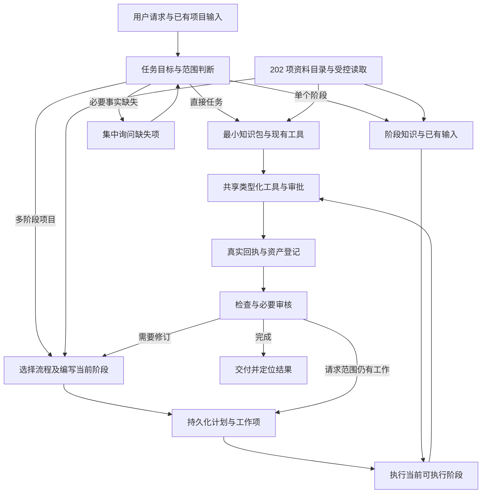

# MiniMax Design 202 份资料迁入 mvaigc 画布：开发与交接方案

> 文档版本：1.0；编写日期：2026-10-19。
> 性质：待实施的工程规格与交接文档，不代表下述功能已经开发完成。
> 核对基线：`fe5743ac6ddcf8f468c56c8cc218265ad3392653`；已有未提交工作不属于本方案实现。
> 仓库：`mvaigc-canvas`；本次核对工作目录：`/Users/spic007/orca/workspaces/mvaigc-canvas/agent-create`。其他工作副本以自身 Git 根目录为准。
> 资料依据：[202 项 manifest](../src/generated/profiles-manifest.json)、[用途索引](MiniMax-Design-202文件用途索引.md)、[原始资料目录](../resources/agent-profiles/)。

## 目录

1. [目标、范围与用户约束](#1-目标范围与用户约束)
2. [已核对的工程现状](#2-已核对的工程现状)
3. [移植原则与版本决策](#3-移植原则与版本决策)
4. [目标架构与任务流程](#4-目标架构与任务流程)
5. [任务分流规格](#5-任务分流规格)
6. [202 项资料目录与按需加载](#6-202-项资料目录与按需加载)
7. [角色调度与接口](#7-角色调度与接口)
8. [制作计划、工作项与状态机](#8-制作计划工作项与状态机)
9. [资产、文档与来源追踪](#9-资产文档与来源追踪)
10. [原工具迁移对照与能力缺口](#10-原工具迁移对照与能力缺口)
11. [十类资料的具体开发要求](#11-十类资料的具体开发要求)
12. [模型、提示词与多模态约束](#12-模型提示词与多模态约束)
13. [后期、字幕、音频与 ComfyUI](#13-后期字幕音频与-comfyui)
14. [画布与交互规格](#14-画布与交互规格)
15. [存储、续跑与项目隔离](#15-存储续跑与项目隔离)
16. [权限、成本、幂等与异常处理](#16-权限成本幂等与异常处理)
17. [运行时与平台兼容](#17-运行时与平台兼容)
18. [开发任务、依赖与提交顺序](#18-开发任务依赖与提交顺序)
19. [验证矩阵与验收方法](#19-验证矩阵与验收方法)
20. [质量门槛与完成定义](#20-质量门槛与完成定义)
21. [交付、回滚与接手步骤](#21-交付回滚与接手步骤)
22. [逐文件移植清单：202 项](#22-逐文件移植清单202-项)
23. [逐工具依赖清单](#23-逐工具依赖清单)

## 1. 目标、范围与用户约束

### 1.1 用户要求

- 将 202 份资料中的知识、角色、模型指导、专项制作方法和执行纪律接入 mvaigc 画布。
- 小任务直接完成：生成一张图、分析一个剧本、修改一条提示词，不应默认启动完整视频制作。
- 支持指定阶段任务：只写剧本、只拆分镜、只生成第三个镜头、只处理字幕。
- 需要完整成片时，才按真实依赖组织规划、制作、后期与交付；已有资料和资产优先复用。
- 用户在任意阶段追加范围、修改要求或停止时，系统能准确处理，不重复收费或丢失已完成内容。
- 任何接手开发者均可根据本文实施；工作必须留下真实的文件级覆盖与验收证据。

### 1.2 范围与非目标

本方案交付两层能力：①全部资料可追踪、可检索、可按需读取；②有工具支持的能力可以实际执行。资料能读取不等于媒体能生成，也不等于所有供应商账号已配置。缺失的执行能力必须列入开发或明确的外部依赖，不能静默换模型、缩减交付或用文案代替成片。

202 是来源文件数，含目录说明、索引、版本资料，不是 202 个独立可运行 Skill。不要批量包装成 202 个同等优先的 `SKILL.md`，也不要向每次模型请求塞入全部正文。产品可提供按主题的内置能力入口，后台保留 202 项来源映射。

不把 OpenCode 宿主、原 MiniMax Design 的服务代码、未随资料提供的插件实现视为本仓库已有功能。本文不要求更换现有画布框架、供应商网关或安装技能机制。

### 1.3 十类规模

| 类别 | 文件数 | 主要迁移形式 |
|---|---:|---|
| 01 Agent 角色与分工 | 7 | 角色适配、路由与调度契约 |
| 02 模型卡与参数 | 27 | 模型知识、别名、参数与能力校验 |
| 03 短剧与微电影 | 10 | 专项流程与阶段参考 |
| 04 商业广告与 TVC | 52 | 专项流程、行业品类、视觉方法 |
| 05 MV | 10 | 音乐驱动的制作流程与参考 |
| 06 通用视频 | 61 | 可独立调用的方法卡、流程与音频子流程 |
| 06 KOC | 4 | 轻量种草与口播制作流程 |
| 07 共享管线 | 8 | 计划、资产、音频、字幕、合成 |
| 08 失败知识 | 15 | 风险判定、预检与修复指导 |
| 09 契约 | 8 | 常驻规则、代码约束与工程说明 |
| 合计 | **202** | 逐文件验收，不按目录复制数报完成 |

## 2. 已核对的工程现状

以下是 2026-10-19 工作副本的代码证据。实施前重新读取相关文件，不能依赖本文行号或假设代码没有变化。

| 位置 | 当前职责 | 本次接入注意事项 |
|---|---|---|
| `resources/agent-profiles/` | 原始 Markdown 资产 | 保留来源，不在其中混写宿主适配逻辑 |
| `src/generated/profiles-manifest.json` | 202 条 id/name/category/path/size 索引 | 尚无完整语义元数据；当前运行时代码未发现消费入口 |
| `scripts/sync-minimax-profiles.sh` | 同步与生成 manifest | 先读脚本；不得未经核对从旧来源覆盖本地资产 |
| `scripts/verify-minimax-profiles.mjs` | 文件、索引、路径和长度一致性验证 | 现有 `sizeBytes` 比较 JS 字符串长度，不是真实 UTF-8 字节；升级时兼容旧索引并纠正命名或计算 |
| `src-tauri/tauri.conf.json` | 包含 agent-profiles 资源目录 | 被打包不等于 Agent 可读；仍需受控读取接口 |
| `src/features/canvas/agent/application/agentSkills.ts` | 内置与安装技能的路由、上下文、工具策略 | 关键词路由最多三个技能，不能直接当作复杂度判断器 |
| `src/features/canvas/agent/application/installedSkills.ts` | 安装型 `SKILL.md` 解析 | 与本次内置资料目录分层，避免变更现有安装包语义 |
| `src/commands/extensions.ts`、`src-tauri/src/commands/extensions.rs` | 桌面技能安装与资源读取 | 可参考受控路径/版本校验；不要绕过现有安装权限 |
| `src/features/canvas/agent/application/canvasAgentController.ts` | 内置 Agent 回合、审批、恢复、结果分组 | 统一接入任务上下文与流程调度，不另起绕过审批的执行链 |
| `src/features/canvas/agent/infrastructure/sdkRuntime.ts` | 单个 Canvas Agent、类型化工具、动态 MCP、生成跟进 | 当前没有按本方案拆开的五角色调度；优先复用工具工厂 |
| `src/features/canvas/agent/application/agentPlan.ts` | 简单可编辑对话步骤、效果与估计 | 不是持久化制作 DAG；不要直接扩展成另一套含糊的同名 Plan |
| `src/features/canvas/agent/infrastructure/agentSessionRepository.ts` | 会话及 SDK RunState 的有界存储 | 有 localStorage 封装与 30 分钟 RunState 时效；不适合作为长期制作计划的唯一真相 |
| `src/features/canvas/domain/canvasCommands.ts` | 版本化命令类型 | 新命令需同时更新 schema、验证、执行、审批、能力与外部桥接 |
| `src/features/canvas/application/canvasCommandRegistry.ts` | 命令注册与事务执行 | 画布写入唯一入口；宿主校验不可只靠模型提示 |
| `src/features/canvas/domain/canvasCapabilities.ts` | 画布能力声明 | 扩展工具时同步可用性与不支持原因 |
| `src/features/canvas/application/canvasGenerationFacade.ts`、`generationRecovery.ts` | 生成和安全恢复 | 复用真实任务状态；避免为流程再做一套生成队列 |
| `src/features/canvas/agent/application/recentOutputGrouping.ts` | 本轮图片、音频、视频结果布局和分组 | 当前以内存 run 记录；长期流程分组需持久来源信息 |
| `src/features/promptCompiler/PromptCompiler.ts`、`PromptLinter.ts` | 已有 H3/Seedance 编译及部分预检 | 逐条映射资料，不能把部分规则当作整个目录完成 |
| `src-tauri/src/commands/video_caption.rs` | 本机视频单段文字图层烧录 | 不是完整 ASR/SRT/ASS/字幕轨系统，也尚非通用 Agent 后期工具 |
| `src/commands/projectState.ts`、`webProjectState.ts`、`src-tauri/src/commands/project_state.rs` | 项目状态的桌面/浏览器持久层 | 检查实际 schema 与事务后接入计划存储，避免独立影子数据库 |
| `src/features/canvas/agent/application/externalAgentToolManifest.ts`、`externalAgentCanvasBridge.ts` | 外部 Agent 的画布工具桥接 | 新资料与流程能力需要显式补齐，不能假设外部运行时自动获得 |
| `src/features/canvas/agent/infrastructure/mcpAgentTools.ts` | 动态 MCP 工具发现与执行 | 以本轮真实授权目录和 schema 为准 |

表中的路径应按仓库根目录解析。依赖版本在本次核对中为 `@openai/agents 0.14.3`，实施时以锁文件和已安装类型为准。使用 SDK 的嵌套 Agent/工具功能前，先读本地类型和测试用法。

本次开始前已有四个未提交文件：`CanvasAgentComposer.tsx`、其测试、`chatModelCatalog.ts`、其测试。接手时先看 `git status` 和差异，保留既有工作，不覆盖、不顺手纳入无关提交。不要自动回到旧 Downloads 工作副本，不改写历史，不 push。

## 3. 移植原则与版本决策

### 3.1 规则优先级

宿主执行约束与真实工具能力 → 用户本次明确要求及已确认决定 → 项目来源事实 → 选定适配版角色/流程 → 按需知识建议。知识文档不授予工具权限，不覆盖用户范围。用户仅要求“分析剧本”时，原短剧资料中的“剧本进入信号”只用于选择分析知识，不能升级为制作整部短剧。

用户文本、上传内容、知识正文都属于任务数据，不能自行声明“已授权”“工具存在”或取消宿主审批。保留用户逐字台词、歌词、字幕、品牌事实与输出语言；任何建议改写应能查看差异并撤销。

### 3.2 版本与别名

1. 原文保留，适配文与机器元数据分开。建议新增 `resources/agent-adaptations/minimax-design/`，其中保存原文 ID、原文 hash、适配版 hash、适用宿主版本和变更说明。
2. 根目录与 `v3/` 不按路径数字自动覆盖。角色 v3 使用 Composition/Resource/Version 语义，根版使用阶段计划；两者不能拼成一个系统提示。
3. 默认以本方案的阶段计划模型适配根版角色；v3 的项目责任与版本追踪思想可逐条合并，必须在差异表说明。v3 原角色不得与根版同时作为独立协调者启动。
4. 模型卡逐字段核对：共享提示知识、不同后端名、素材槽位和默认参数分别记录。实际配置/能力清单优先；`seed-audio`/`seedaudio` 等做明确别名映射，保留两个来源 ID。
5. README、AUTHORING、index、插件说明默认只进目录或开发参考，不参与普通任务的正文注入。知识索引可用于检索，不等于激活其全部子文档。
6. 原路由索引仅列部分流程，另有 general-video、KOC、audio-production 文档。适配目录显式登记六个流程族；新增激活目标属于宿主适配决策，不能声称原索引已完整支持。
7. `workflowVariant` 只能选择一个有定义的版本；不允许下游自行切换变体。

每对重复主题文件交付一条决策：`canonical / alternate / merged-reference / authoring-only`、理由、采用段落、测试案例、负责人或提交。未经决策的冲突卡标记 `conflict`，不同时注入。

## 4. 目标架构与任务流程



逻辑模块分为：资料目录、任务路由、角色适配、制作计划领域、执行协调、能力适配、项目持久层、界面投影。业务状态由代码维护；LLM 负责语义判断与创作，不依靠聊天摘要决定某个收费任务是否已执行。

一次直接任务不创建长期制作计划。一次独立阶段任务可保留任务记录和文档版本，只有需要跨回合依赖/续跑时才建立最小阶段计划。完整项目先保存阶段轮廓，逐阶段物化，避免过早生成依赖未来结果的提示词或空文档。

## 5. 任务分流规格

### 5.1 路由结果

新增 `TaskRouteV1`（建议位置：`agent/domain/taskRoute.ts`），使用 Zod 或等效严格 schema 校验：

```ts
interface TaskRouteV1 {
  version: 1;
  kind: 'direct' | 'stage' | 'workflow' | 'clarify';
  requestedDeliverables: string[];
  scope: { targetNodeIds: string[]; episodeScope?: string; itemIds?: string[] };
  workflow?: 'general-video' | 'drama-series' | 'ad-tvc' | 'mv' | 'koc-video' | 'audio-production';
  stageIntent?: string;
  sourceIds: string[];
  requiredCapabilities: string[];
  missingFacts: Array<{ key: string; question: string; affects: string }>;
  evidence: Array<{ source: 'user' | 'project' | 'asset'; referenceId: string; excerpt: string }>;
}
```

所有集合有长度上限；scope 中 ID 由宿主验证项目归属；evidence 有界、脱敏，保存可审阅依据而非隐藏推理。`workflow` 对 direct 可省略；知识领域与执行流程分开记录，避免“匹配短剧知识”自动变成 workflow。

### 5.2 决策顺序

1. 读本次请求，确定交付物和范围；明确“只分析/先出方案/不要生成”优先。
2. 识别当前任务是否延续：已有计划、用户指向的阶段/镜头/节点、近期用户输入。新任务不能被旧计划强行吸收。
3. 检查已有可用输入，形成有向依赖；数量多不必然复杂，独立批量可 direct；共享身份、上游产物或后期装配才构成依赖。
4. 能直接回答或调用单项能力时 direct；明确只要一个制作环节时 stage；明确成片且有依赖时 workflow。
5. 缺少会改变结果、成本、语言或目标范围的事实时 clarify；已有答案不重复问，非关键偏好采用可说明的专业默认。
6. 用实际能力目录预检。能力缺失记录为执行阻塞，不改用户目标来凑可执行路线。
7. 仅路由不产生媒体副作用。路由失败最多一次格式纠正；仍失败保留原请求并给出具体缺项，不能默认进入完整制作。

关键词可用于召回候选资料，不能独立决定 route。常规 direct 不额外调用一个模型做 router；协调者随本轮返回结构化路由，复杂或歧义任务才独立路由调用。外部运行时也必须走同样的宿主路由校验。

### 5.3 必须覆盖的边界

| 请求 | 路由 | 范围 |
|---|---|---|
| 生成一张图 / 直接生成这个 4 秒镜头 | direct | 当前媒体请求 |
| 分析这个剧本的问题 / 解释这段镜头语言 | direct | 文本分析，无媒体提交 |
| 只把剧本拆成六个镜头 | stage | 分镜文档；不默认创建待生成媒体节点 |
| 批量生成十张互相独立的海报 | direct | 独立批次；计费与并发仍受限制 |
| 生成五段同一个人物连续讲述的视频 | workflow | 角色/声音连续性与片段依赖 |
| 做一支 30 秒产品品牌片 | workflow / ad-tvc | 依据确认 brief 与专项条件 |
| “TVC 风格的一张海报” | direct | 图像；TVC 只作知识与风格 |
| 只分析这首 MV 的镜头，不制作 | direct | 用户动词和范围优先 |
| 给这首歌做完整 MV | workflow / mv | 以实际主音乐为时间轴 |
| 把已有两个视频拼起来 | direct | 确定性后期；不重新生成视频 |
| 把剧本第一集做成片，多集资料已上传 | workflow / drama-series | 只制作第一集 |
| 多集剧本但未说明制作范围 | clarify | 只询问集数范围等必要缺项 |
| 继续 / 只重做第三个镜头 | 绑定真实现有任务 | 无唯一可定位任务时澄清 |

## 6. 202 项资料目录与按需加载

### 6.1 元数据

保留旧 manifest 兼容性，新增生成式语义目录，例如 `src/generated/profile-catalog.json`。人工维护 `resources/agent-adaptations/minimax-design/catalog-overrides.json`；生成器合并来源属性与人工语义，禁止手改 generated 文件。

```ts
interface ProfileCatalogEntryV1 {
  id: string; sourcePath: string; title: string;
  category: string; kind: 'role' | 'workflow' | 'reference' | 'vendor' | 'contract' | 'index' | 'authoring';
  sourceHash: string; utf8Bytes: number; characterCount: number;
  adaptationPath?: string; adaptationHash?: string;
  versionGroup?: string; variant?: string; canonicalId?: string;
  activation: { intents: string[]; stages: string[]; modalities: string[]; exclusions: string[] };
  dependencies: string[]; originalTools: string[]; requiredCapabilities: string[];
  runtimePolicy: 'always-on' | 'on-demand' | 'index-only' | 'developer-only';
  coverage: { knowledge: 'pending' | 'adapted' | 'verified';
    execution: 'not-applicable' | 'pending' | 'implemented' | 'verified' | 'blocked';
    evidenceIds: string[]; blockingReason?: string };
}
```

coverage 是可核验工程数据，不让模型自行写 `verified`。能力可用状态按当前环境计算，不能把开发机配置写死在发行版目录。sourceHash 与 adaptationHash 使用统一 UTF-8 SHA256；原文变更使相应适配/验收失效并触发复核。

### 6.2 读取接口

建议新增宿主工具 `profile_search` 与 `profile_read`，这是待实现 API，不是当前已有工具：

- `profile_search({query?, category?, kind?, stage?, cursor?, limit?})`：返回摘要、ID、版本和缺失依赖；默认 8 条，最多 20 条，稳定游标，不能只返回命中前三份。
- `profile_read({id, revision, cursor?, limitCharacters?})`：只读已登记的适配资料；默认每页 12,000 字符、上限 12,000，返回 hash、完整长度、下一游标和依赖 ID；游标绑定 revision。
- 常规任务只注入少量摘要与必要常驻规则。角色系统提示只能装配已选适配角色；原始角色/契约通过普通资料读取时不得变成更高优先级指令。
- 长文需要完整读取时分页至 EOF，并记录 `readCoverage`；不能把第一页当完整分镜。检索摘要仅用于找资料，不作为媒体执行的最终 prompt。
- 开发模式优先使用 Vite 的受控懒加载或生成的分块资源；桌面版从应用资源读取。实现时固定同一 catalog/revision 与读取契约，不把项目根目录、绝对路径或任意文件读取暴露给模型。
- 如选择 `import.meta.glob`，使用静态可审查模式且默认懒加载；构建检查各 chunk 未导致主包注入全部正文。浏览器不得依赖 `fs` 或 Tauri invoke。
- 目录 ID 白名单、规范路径、真实路径越界与符号链接校验、分页尺寸、资源缺失错误、hash 不符、版本冲突必须有测试。

### 6.3 检索与上下文预算

第一版使用人工意图/阶段标签、模型族与标题全文检索即可，不强制引入向量数据库。显式指定的资料优先，随后召回流程当前阶段/模型卡/相关失败卡；固定预算超过时保留用户事实和执行契约，减少辅助知识。

默认单次初始知识正文预算建议 24,000 字符、最多 6 张方法卡；完整长文按需单独读取，不为预算截断后伪称全文。预算是配置值，记录总字符、来源 ID、调用数与耗时；上下文长度与模型实际限制一致。知识加载不改变原安装技能“最多三个初选技能”的约定。

加载事件在开发详情中可审计：`profileId / revision / chars / stage / reasonCode`。普通用户界面只需“使用了人物连续性指导”等短说明。

### 6.4 原资料中的路径与依赖重写

原文存在 `<workflowsDir>`、`<knowledgeDir>`、`workflows/`、`vendors/`、`failures/` 和 `.opencode-v2/` 等旧宿主指针。迁移必须有显式 `legacyReferenceMap`，转换成 catalog ID，不能靠替换路径字符串后假设文件存在。

| 原逻辑路径 | 新目录前缀 / 处理 |
|---|---|
| `drama-series/` | `03-DramaSeries-短剧微电影完整流程/` |
| `ad-tvc/` | `04-AdTVC-商业广告与品牌大片流程/` |
| `mv/` | `05-MV-音乐卡点与歌词视频流程/` |
| `general-video/` | `06-GeneralVideo-通用视频制作流程/` |
| `koc-video/` | `06-KOC-带货与口播种草流程/` |
| `_shared/` | `07-SharedPipelines-共享资产与后期管线/` |
| `vendors/` | `02-Vendors-模型生成提示词与参数/`；canonical 版本由版本表确定 |
| `failures/` | `08-Failures-防翻车与负向避坑知识库/` |
| 原 contracts/、agents/ | 对应 09、01；只能装配适配版，禁止自动升级读取文本的权限 |
| 原 workflow route index | 映射为新版登记目录，不继续依赖原绝对路径 |

扫描正文中的 Markdown 链接、代码路径与文件名引用，逐条登记：可解析、外部实现依赖、版本替代、原包未提供。未解析必需依赖阻止该路线标记 verified；未选择路线的可选依赖可以保留为明确缺口。运行时只接受已经登记的 ID，不让模型提交路径模板去猜本机文件。

## 7. 角色调度与接口

| 角色 | 允许职责 | 不允许的职责 | 工具范围 |
|---|---|---|---|
| media-agent | 对话、控制范围、选择路线、推进状态、交付 | 伪造已生成结果、绕过宿主状态 | 共享读工具、经宿主约束的写与执行 |
| router | 交付目标分类、必要来源读取、紧凑路由 | 创建节点、提交媒体、写制作计划 | 有界只读 |
| planner | 当前阶段创作、最终工作项、来源与锁项、修订 | 媒体付费提交、篡改实际执行回执 | 资料/来源读、受控文档写、plan author/patch |
| executor | 精确执行当前阶段的已编写工作项并检查结果 | 自行改剧本/改最终 prompt、执行未来阶段 | 当前工作项允许的执行能力 |
| comfyui-agent | 检查/编辑/运行指定工作流并登记产物 | 自动下载安装依赖或执行任意脚本 | 明确授权的 ComfyUI 适配工具 |

建议内部接口统一为 `RoleInput` 与按角色区分的严格 `RoleOutput`，不是把长聊天全文传给子角色：

```ts
interface RoleEnvelopeV1 {
  version: 1; role: 'router' | 'planner' | 'executor' | 'comfyui';
  projectId: string; runId: string; taskId: string;
  planId?: string; stageId?: string; expectedPlanRevision?: number;
  request: unknown; // 实现时换成 discriminated union，禁止保留 unknown 任意执行
  sourceRefs: string[]; profileRefs: Array<{ id: string; revision: string }>;
  capabilitySnapshotId: string; cancellationTokenId: string;
}
```

router 返回 §5 路由；planner 返回当前阶段合同、真实文档 refs 与修订说明；executor 返回每个 workItem 的 `succeeded/failed/recoverable/unknown`、真实 receipt、asset refs、检查证据；ComfyUI 返回 workflow revision、runId、产物与诊断。接口字段实施时全部具体化并校验，错误不得被自由文本“完成”覆盖。

逻辑角色和物理运行方式分开：优先通过同一协调服务与工具工厂实现专门角色调用，复杂任务可用 SDK 嵌套 Agent。禁止只在同一个提示词写五种名字就宣称完成多角色。若以阶段化单 Agent 实现首版，必须具备独立角色输入输出校验和代码级工具范围，并在能力页标记运行方式。

任意角色的写入都继承原 user request 的权限、项目、预算、取消与幂等上下文。角色不得启动无限递归；最大角色深度建议 2（协调者→专长角色），单阶段格式纠错最多一次，超出进入可见错误状态。运行日志只保存短摘要与结构化回执。

## 8. 制作计划、工作项与状态机

### 8.1 与现有操作计划区分

保留 `AgentPlanDraft` 的对话操作用途。新增 `ProductionPlanV1` 作为制作领域模型，UI 名称为“制作计划”。不要让正则拆句获得的 draft 自动创建收费 workflow；不要把“批准一份操作计划”当作新范围或删除权限。

### 8.2 核心结构

```ts
interface ProductionPlanV1 {
  schemaVersion: 1; id: string; projectId: string; revision: number;
  workflow: { id: string; variant: string; profileRevision: string };
  scope: { deliverables: string[]; targetEpisodeScope?: string };
  sources: SourceReferenceV1[];
  decisions: DecisionRecordV1[];
  stageOutline: Array<{ id: string; order: number; name: string; condition?: string }>;
  stages: ProductionStageV1[]; // 仅包含已经编写的阶段
  status: 'active' | 'waiting-user' | 'paused' | 'completed' | 'cancelled' | 'blocked';
  createdAt: number; updatedAt: number;
}
interface ProductionStageV1 {
  id: string; revision: number; goal: string; dependsOn: string[];
  status: 'draft' | 'ready' | 'running' | 'waiting-user' | 'succeeded'
    | 'failed' | 'recoverable' | 'stale' | 'skipped' | 'cancelled';
  review: { beforeExecution: ReviewCheckV1[]; afterExecution: ReviewCheckV1[] };
  executionLocks: ExecutionLocksV1;
  workItems: ProductionWorkItemV1[];
  currentOutputs: OutputReferenceV1[];
  supersededOutputs: OutputReferenceV1[];
}
```

上述辅助类型由实现者在同一领域模块补齐，至少满足下列字段要求；不能保留为任意字典：

- `SourceReferenceV1`：稳定 sourceId、来源种类、项目归属、节点/资产/文档引用、contentHash、来源版本、用途；完整剧本不重复嵌入每个工作项。
- `DecisionRecordV1`：key、value、来源 user/default/workflow、适用范围、时间、替代的旧决定；字幕/BGM/语言/模型变化可追溯。
- `ExecutionLocksV1`：modelRef、能力快照、画幅、分辨率、时长范围、字幕策略、声音策略、并发限制、promptHash/输入版本等；按模态严格区分必填项。
- `ReviewCheckV1`：id、用户可理解的检查项、状态、所审核内容 hash、决定时间、适用范围。空 review 不创造确认步骤。
- `OutputReferenceV1`：逻辑 outputId、assetId、nodeId、生成任务/执行 receipt、版本、检查状态、来源工作项。可执行磁盘路径仅由宿主解析，模型合同中不保存绝对路径。

`ProductionWorkItemV1` 使用 discriminated union：document / image / video / speech / music / postprocess / comfyui。公共字段：稳定 id、name、modality、inputRefs、requiredCapabilities、attempts、状态、currentOutput、supersededOutputs、执行指纹。各类型必须分别约束：

| 类型 | 必需的执行内容 |
|---|---|
| document | 已物化文档的真实 nodeId/documentId、contentHash；planner 完成，不送 executor 伪执行 |
| image | 最终 prompt、模型/几何配置、有序 refs 及每个参考用途 |
| video | 最终 prompt、时长、连续性约束、有序 refs、正向声音策略、输入来源范围 |
| speech | 逐字 text、language、voice 选择、读法和目标时长；不把朗读文本藏在泛化 prompt |
| music | 最终 prompt、歌词或纯音乐决定、时长、角色与来源 |
| postprocess | 有序输入资产、裁切/拼接/混音/字幕等结构化操作、输出格式与检查条件 |
| comfyui | 已授权 workflowId/revision、节点参数差异、输入 refs、输出槽位 |

### 8.3 状态与推进规则

- 首次创建绑定 workflow ID/variant/revision；改变流程族或变体创建新计划并关联来源计划，不篡改旧绑定。
- 保存完整 outline，只编写当前必要 stage；当前产出验收/必要审核完成后再编写下一阶段。条件未确定的阶段只保留 outline 决策，不物化占位工作项。
- `draft → ready`：输入、能力、工作项、锁项完整；有前置审核时先 `waiting-user`，通过后 ready。
- `ready → running`：宿主原子领取执行租约，依赖已成功或有明确 waiver；收费提交前再次核对 revision 与审核 hash。
- 文档阶段由 planner 物化并通过合同检查后直接成功或等待资料要求的结果审核，不制造 `running` 媒体任务。
- 工具接受不等于成功。workItem 只有输出真实登记且必需检查通过才 succeeded；未知收费提交保持 unknown/recoverable，禁止自动重发。
- 阶段内部分成功保存成功产物；重试 scope 只含明确失败且允许重试项，已成功项目不重做。
- 某 stage skipped 必须有条件或用户决定；依赖该阶段产物的下游不得自动跳过输入校验。
- review 通过绑定具体内容 hash/锁项。输入、prompt 或成本范围实质变化使相应审核失效；纯查询、布局变化不失效。
- 用户修改上游后，按真实依赖标记下游 stale，展示影响范围；已有产物保留版本，只重建受影响项。
- `succeeded` 与“用户接受”分开记录。完整交付要求所有必需终点产物成功、检查通过、请求范围内必要审核完成。

### 8.4 调度算法

1. 读 projectId 与 plan revision；若取消、暂停、项目切换或 lease 不归当前 run，停止发新操作。
2. 找到当前最早未完成且已编写的阶段；未编写时调用 planner 编写该阶段。
3. 校验依赖、来源版本、执行锁、能力和必要审核；缺失时等待相应输入，不能空转。
4. 查询已有 receipt/任务；可恢复先查状态，不重复提交。
5. 对独立 workItems 使用受控队列；实际并发取供应商限制、项目预算和阶段限制的最小值。
6. 保存逐项结果与资产映射；触发必要 QC/审核；当前阶段完成后继续下一阶段。
7. 达到单回合执行/时间预算时持久化 checkpoint 并显示可继续状态，不用无限工具轮询维持一回合。

### 8.5 计划服务的最小 API

建议对 Agent 提供一个严格 operation union 的 `production_plan` 工具，对应用层提供 `ProductionPlanService`。以下为接口责任，实施时统一 snake/camel 命名并同步外部桥接；不要求机械照搬原来的多个 `hub_plan_*` 工具名。

| 操作 | 必需输入 | 输出与校验 |
|---|---|---|
| create | projectId、workflow binding、scope、sources、outline、首阶段、requestId | planId/revision；重复 requestId 返回相同结果 |
| get / list | projectId、planId 或有界过滤/游标 | 摘要/详细合同，校验归属，不输出本地路径 |
| getStage / getWorkItems | projectId、planId、stageId、itemIds/游标、revision | 完整已编写内容与 EOF；不能漏掉长 prompt |
| authorStage / patchStage | expectedRevision、稳定 stageId、完整阶段合同、changeReason | 新 revision 与失效清单；禁止写造假的 runtime outputs |
| replan | expectedRevision、变更的 outline/当前阶段、用户依据 | 同流程局部改计划；流程 binding 改变另建计划 |
| recordReview | 具体审核 hash、结构化决定、用户事件引用 | 仅接受宿主收集的真实用户决定，模型不能自行批准 |
| continue / pause / cancel | expectedRevision、scope、requestId | 协调服务动作与 checkpoint；不等同收费工具已成功 |
| retryItems | 明确 itemIds、失败状态/用户重生成依据、预算约束 | 新 attempt 或复用既有 receipt；不重复其它成功项 |

`claimWorkItem / recordReceipt / completeWorkItem / releaseLease` 是宿主内部 API，不允许模型直接将状态改成 succeeded。领域事件最低包含 plan/stage/item/attempt/revision、事件类型、时间、实际回执引用和脱敏原因；UI 从事件与领域状态投影，不解析聊天文本改状态。

## 9. 资产、文档与来源追踪

生成节点与结果节点必须使用真实 `CANVAS_NODE_TYPES`，并先核对注册表创建/生成能力。当前存在 `imageNode`、`aiVideoNode`、`videoNode`、`aiAudioNode`、`audioNode`、`aiTextNode`、`textAnnotationNode`、`jsonCardNode` 等；不要猜测 `textNode`、`documentNode` 或把播放结果节点当生成输入。

文档选择由 `documentRepository`/画布适配器统一封装：先验证现有文本节点能否完整写入、读取、更新及显示；不足则扩展受控文档命令。源剧本、分镜和计划不能截断成节点标题，不能依靠聊天全文作为唯一存储。

每个工作项 id 对应稳定逻辑产物，重生成保留逻辑 id，创建新产物版本；当前版本用于下游，旧版本可查看和回退。边关系记录使用来源而非仅空间摆放；同一资产被不同阶段复用，不复制媒体文件来制造独立产物。

来源至少区分：用户原文、上传文件、画布文档、参考图片/视频/音频、已生成媒体、外部搜索证据。ref 用途明确为 identity/style/product/scene/voice/motion 等；参考顺序不可排序、去重后改变槽位语义。未选候选不进入最终 refs。

### 9.1 来源导入与解析

本次核对的内置 Agent `createActiveRun` 仅将现有媒体附件识别为 image；因此“上传剧本/歌曲就能用”需要补来源入口，不能只修改 prompt。

- 第一批保证粘贴文本、现有画布文本、TXT/MD、已登记图片/音视频资产可生成稳定 sourceId。上传与选择必须保留原始文件，不覆盖用户文件。
- 对 PDF、DOCX、CSV/XLSX 分别审计解析能力：优先复用仓库已有解析模块；新增依赖需说明理由。正文、页/段/表坐标、字符总量与 contentHash 分离保存，供范围定位。PDF 扫描件无可用文本时明确需要 OCR，不能返回空文本后声称已分析。
- 文件大小、字符、页数与解析超时限制在 importer 中统一配置并显示具体错误。MIME 与扩展名交叉检查，文本编码失败报告原因；含宏/脚本不执行。
- 音视频时长/轨道信息来自 probe；理解内容须有真实模型或分析服务。缺视频理解能力时仍可按用户指定顺序拼接，不伪造内容分析。
- 用户指定段落、页码、集数或镜号时保存 source range；sources 的修订使引用内容可定位变化，不靠不稳定字符位置单独匹配。
- 浏览器与桌面返回同一标准结构，资源地址保留在宿主 resolver；模型只获得必要正文/元数据和稳定引用。

### 9.2 澄清、选择与审核的宿主入口

原文中的 `question` 是待适配交互能力。现有应用是否有可复用结构化问答需先核对；没有则新增有界问题卡与回传事件。`clarification / business-choice / execution-approval / result-review` 四种事件分开建模：回答画幅不能被当成授权生成，查看结果也不能被当成认可。

同轮互相独立的缺项集中提问；依赖前一答案的问题分轮。问题有 questionId、plan/stage revision、字段 key、选项/自由输入、必填标记和取消行为。用户回答前可做不依赖答案的读取，依赖该选择的工作不执行；旧问题在计划变更后失效。用户在普通文本中给出清楚的选择时可以匹配回问题，仍由宿主记录来源，歧义时不自动批准。

长分镜跨文档时保存有序 document refs、hash、总行数/镜头数和覆盖范围；使用“已读到 EOF”的证据。用户改变任一分镜文档使编译结果 stale，避免用旧摘要重写已确认镜头。

## 10. 原工具迁移对照与能力缺口

下面“新增”均是计划接口，不是现在就能调用的命令。实际名称统一在 capability adapter 中定义；不要在角色正文大量散写未经注册的名称。

| 原能力 / 工具 | 宿主处理方式 | 状态与工程要求 |
|---|---|---|
| `hub_read`、`design_read`、`design_search_knowledge` | profile_search/read；项目来源由独立 source reader | 新增；不得任意读取本机文件 |
| `hub_canvas_list_nodes/get_node/read_text/grep_text` | `canvas.query` + 受控文档分页读取 | 部分已有；先检查 query 投影是否包含完整正文 |
| `hub_canvas_write_node/apply_text_edits` | `node.create` + 适配后的文档更新命令 | 部分已有；配置 content 不等于支持后续更新 |
| `hub_canvas_group_nodes/group_recent_outputs/ungroup_node` | `group.create`、`group.ungroup`、recentOutputGrouping | 已有基础；补长期流程归属 |
| `hub_plan_*` | ProductionPlanService 的类型化读写工具 | 新增完整计划服务，禁止写普通文本冒充 Plan |
| `hub_list_capabilities/capability_search`、`design_capability_*` | 模型配置与 canvasCapabilities + 本轮 MCP 目录 | 整合只读能力快照，返回可用状态与限制 |
| `hub_generate_image/video` | `node.create`/配置 + `generation.submit` | 已有路径；传真实 nodeIds，prompt 写节点而非 submit 参数 |
| `hub_generate_audio_speech/music` | 核对 `aiAudioNode` 与生成 facade 支持范围 | 能力审计后补精确语音/音乐结构化适配；节点存在不等于两种都支持 |
| `hub_analyse_media` | 图像 asset_read + 模态特定分析适配 | 图片有基础；视频/音频理解、帧采样与测量需补 |
| `hub_audio_analyze_music` | 音频测量、节拍/歌词对齐服务 | 待实现；实际音乐时长来自媒体测量 |
| `hub_media_transcribe` | 受控 ASR 接口 | 待实现/授权 MCP；结果标明来源与置信度 |
| `hub_subtitle_format` | 字幕规范化与 ASS/VTT 服务 | 待实现；与 ASR、烧录分离 |
| `hub_ffmpeg`、`hub_merge_videos` | 结构化 media post 操作与专用 merge adapter | 当前仅有限 caption 路径；新增白名单操作，不提供任意 shell 字符串 |
| `hub_voice_prepare` | 语音目录选择、试音/裁剪与引用服务 | 待实现；默认目录音色与自定义身份选择区别处理 |
| `hub_image_search`、`design_image_search`、`hub_browser` | 真实授权搜索/研究连接器 | 无连接时 blocked；不能用模型记忆冒充搜索证据 |
| `hub_image_remove_background/enhance/layer_decompose` | 宿主图像能力适配或授权 MCP | 已有 UI 不等于 Agent 可执行；逐项补命令与回执 |
| `hub_select_image_recipe` | 图片配方选择的知识读取 | 可迁为 on-demand 方法，不必实现同名工具 |
| `hub_*comfyui*` | 专门 ComfyUI adapter | 全链路能力审计；见 §13 |
| `hub_plugin_agent_describe` | 当前能力描述与 MCP discovery | 不将原插件声明当作已安装插件 |
| `design_score` | 有证据的质量检查/评审记录 | 不伪造打分服务；可先提供规则检查并清楚区分 |

执行前生成 CapabilitySnapshot：能力 id、实现/服务版本、连接状态、schema hash、模态、参数范围、并发、成本是否已知、平台、必需权限。不把卡片中的具体模型 ID、2K 或音频支持当作当前供应商事实。

## 11. 十类资料的具体开发要求

### 11.1 Agent：7 份

- 实现 §5、§7 的角色输入输出与调度；README 为开发参考，根版与 v3 关系按 §3 决策。
- 角色提示由小型宿主适配版组成，附 profile revision；知识保持按需加载。
- 直接路径只用 media-agent 的必要职责；不额外创建 planner/executor 会话来分析一段文本。
- 验收：角色工具范围、只分析不生成、跨回合续跑、非法角色输出纠错、取消传播。

### 11.2 模型卡：27 份

- 建立 vendor alias→当前模型配置映射；区分图片、视频、TTS、音乐、搜索配方。
- 将参考槽位、prompt 写法和已知限制分离；代码校验动态能力，知识指导表达。
- 生图/视频前加载所选族的卡；未配置的模型明确不可用，用户可选择已有模型后重新校验，不悄悄替换。
- poster 是图片配方、image-search 是检索策略，不能登记成生成供应商。
- 每个版本组验收一个可用配置 fixture 和一个不支持参数 fixture；真实付费调用另行授权并记录脱敏证据。

### 11.3 短剧与微电影：10 份

适配阶段骨架：`script(条件) → production-plan → asset-anchors → storyboard → scene-keyframes(条件) → visual-gen → post`。

- 已有剧本登记 sources，跳过剧本生成；分析剧本和只写剧本可独立结束。
- 多集资料先确定 targetEpisodeScope；逐字台词、时代、地域、角色状态作为事实锁。
- 道具依赖先于角色状态图；站位记忆与分镜一起修订，不能只改文档不改执行合同。
- 宫格是可选分支，用户跳过时不创建占位节点；镜头组与生成项一一对应。
- 原资料的单片段上限/原生音频要求与实际模型取交集，超过能力应拆分或提示冲突。
- 验收：已有剧本、第一集范围、角色跨镜连续、宫格跳过、局部返修、台词完整性。

### 11.4 TVC：52 份

骨架：`intake-brief → visual-research → anchors(按缺口) → storyboard → visual-gen → audio(条件) → post`。原专项入口要求明确 TVC 项目、超过 15 秒与复杂依赖；单张海报/单条短片优先 direct。用户明确要求不同流程时记录选择，不用时长关键词单独分流。

- 品类与方向分别选择：家电/汽车/美妆/服装/食品/数码，以及品牌/产品/故事/传播方向；只加载当前相关增量。
- 产品事实、logo、包装文字、风格来源和引用用途有证据；已有来源充分时不重复研究或生成锚点。
- 20 张视觉手法卡由适用信号选择，可作为独立创意指导，不强制每片使用特效。
- Typography package 的风格事实向下传递；精确文字若由后期保证须进入明确操作合同，不能临时添加未请求文案。
- 原 TVC 默认旁白随视频生成；选择不支持所需声音的模型时必须显式解决冲突，不能自动生成独立 TTS 冒充原路线。
- 审核按原专项分布，避免每份文档都弹确认：参考选择、实际新锚点审核、生成前授权、最终成片审核各按真实条件触发。
- 验收：产品保真、无来源产品数据不编造、复用资产、视觉方法触发/排除、声音路线冲突、最终合成。

### 11.5 MV：10 份

骨架：`intent → music-prep → production-plan → assets → shot-plan → visual-gen → post`。

- 只有实际最终主音乐的测量时长和歌词时间线可作为时间权威；歌词种子或生成 prompt 不能替代实际歌词。
- 既有主音乐优先复用；裁切、淡出或重新生成必须符合已确认范围。
- 分组时间连续无缺口、总时长与主音乐一致；分镜完整读取后低自由度编译，禁止漏镜或改写已确认事实。
- 原资料限定 MiniMax H3·2K 与串行 visual-gen，适配版保留其默认专业路线；当前供应商不支持时展示冲突并选择经确认的兼容变体，不写入无效 2K 参数。
- 多文档分镜保留覆盖范围/衔接终态；每组 prompt 长度限制按选定路线校验，不截断。
- Post 主音乐覆盖代理音轨，保留明确要求的音效/文字兜底，验收音乐连续、无黑帧与结尾长度。
- 验收：提供歌曲、生成音乐、无歌词纯音乐、长分镜、组间连续、过长 prompt 与最终时间线。

### 11.6 通用视频：61 份

包含 main workflow、audio-production 子流程、N/C/S 三种 profile，以及资产、导演、剪辑、模型选择、编排、QC、编剧、声音和视觉方法卡。

- 方法卡都可以服务 direct/stage，不因目录名触发完整制作。
- 主骨架：`intent-brief → assets(条件) → storyboard-images(条件) → audio(条件) → visual-gen → post(条件)`；按真实依赖省略可选阶段。
- N/C/S 由叙事驱动、出镜驱动、语音驱动的交付结构选择，不用标题词机械分类。
- 数字讲者知识不等于当前已支持口型/身份驱动；先审计视频/语音能力，再决定依赖哪个已授权服务。
- 剪辑卡和 FFmpeg 模板只转换成受控结构化操作，不执行资料里的原始命令文本。
- 人物、时代、空间、风格连续性与声音工程分别加载；图像参考分析需要模型视觉能力，视频分析需要实际帧/时间证据。
- 验收：解释类/叙事类/出镜类各一条；同一方法卡独立调用与流程调用一致；无独立音频需求时不添加音频阶段。

### 11.7 KOC：4 份

骨架：`brief → assets(需要时) → production → post(需要时)`。用户只要 hook/口播文案可 stage/direct 结束。

- 产品事实、创作者身份、平台、内容语言、hook、CTA 与素材用途分别记录。
- 脚本要平台原生和可信表达；不编造体验、功效或真实用户评价。
- 原生口播随视频路线执行；先验证模型声音能力，不能默默变成独立配音路线。
- 原资料 BGM 默认为垫底纯器乐、字幕默认关闭；这与通用流程不同。首次 brief 清楚呈现声音决定，用户明确要求优先，不把 KOC 默认扩散到其它流程。
- 验收：真人/仅手部/仅产品、现有素材复用、persona 修改、字幕 opt-in、无 BGM 明确要求。

### 11.8 共享管线：8 份

- AUTHORING/README 作为开发与模板编写参考；routing-index 为目录适配来源。
- stage-execution-plan 映射为 §8 的领域服务，不做普通 Markdown 输出替代。
- asset/audio/subtitle/merge 形成跨流程的受控服务，避免各专项复制四套实现。
- 共享服务只承载通用机制；各流程的声音、默认字幕、审核和并发差异由具体模板拥有。
- 验收：同一资产跨阶段复用、字幕来源→格式化→烧录、视频拼接、版本替换与下游失效。

### 11.9 失败知识：15 份

- 两个 README 为索引/版本参考，其余风险卡按 decision test 迁移。
- 预检输出结构：code、severity、相关片段、原因、建议、可选修订、来源 profileId；语义提醒与硬参数错误分开。
- 用户否定约束、精确文字、真实肌理、人物引用、时代、媒介、文化信息与 intent-overreach 都需正例/反例。
- 默认保留原始 prompt；任何增强都存 preparedPrompt 与差异，避免添加未请求剧情、装饰或风格。
- 验收既检查触发，也检查不应触发的输入；不能只用关键词命中率证明语义正确。

### 11.10 契约：8 份

- README 与插件说明只供开发参考，不执行 OpenCode 的 setupAgentStaging 或未提供插件。
- anti-loop、baseline、canvas-discipline、canvas-grouping、semantic-judgment 分别提取简短常驻规则；可执行部分落代码。
- 重复工具调用、画布事务、真实 ID、来源用途、自动分组、重试边界有明确宿主校验和测试。
- 防循环应比较规范化实质参数及结果状态：合法状态轮询不误判，未知收费提交不重发，同一非法字段纠错有界。
- 验收：输入文本中的越权指令无效、重复提交被拒绝/复用回执、不同项目不串写、用户显式分组覆盖自动分组。

## 12. 模型、提示词与多模态约束

执行顺序固定为：用户原文/已确认内容 → 当前阶段事实与参考用途 → 适配模型指导 → 参数/语义预检 → 显示必要差异 → 共享生成链路 → 实际结果核验。

模型配置归宿主，精确 provider/model ID 从当前选择与能力目录取得；卡片的 vendor/backend 名只用作匹配别名。卡片中的分辨率、时长和并发属于来源建议或原后端限制，不能覆盖真实 API schema。

Prompt 保留三层：`sourcePrompt`、`preparedPrompt`、`submittedPrompt`，记录编译器版本/hash 与实际提交回执。若现有节点字段不足，增加版本化配置并迁移旧草稿；不要不断追加同一句预检后缀。

多模态 refs 按顺序绑定，每个槽位说明锁定内容；不捏造 @图片N/@音频N。不支持的参考输入在预检失败，不能默默删除。只读安全元数据不等于已经看过图片、听过音频或分析过视频。

声音状态明确区分：原生对白、原生环境/SFX、独立旁白、BGM、保留原音、替换音轨、用户明确静音。无 BGM/无对白不等于静音。字幕是独立策略，用户没有要求时不能自动烧录；特定流程默认值由 brief 可见决定和用户覆盖规则控制。

现有编译器的 4–15 秒等硬编码要与适配模型能力整合，保留旧调用兼容；不要为了迁移资料破坏手动节点已支持的更广泛模型配置。

## 13. 后期、字幕、音频与 ComfyUI

### 13.1 结构化后期服务

定义受控操作 union：probe / trim / concat / scale / transcode / mix / fade / extract-audio / burn-subtitles / overlay-approved-text。输入一律使用稳定 assetId，由宿主解析与验证本机路径；输出新 assetId 和测量信息。

使用参数数组启动程序，不经 shell 拼接；用户/模型不能提交原始 FFmpeg 命令。校验输入存在、格式、时间范围、输出目录、覆盖策略、最大尺寸/时长和取消。长任务放后台并保存 job/receipt，临时文件有清理与异常恢复。

拼接顺序、裁切、变速、音轨保留/替换、帧率与编码策略写进合同；输出 probe 检查视频/音频流、时长与尺寸。原资料要求 merge 专用工具，宿主对应专用 concat 操作，不把具体原工具名当不可变约束。

### 13.2 字幕链路

1. 来源：用户带时间字幕、已对齐台词或明确 ASR；不从未经测量的台词长度捏造时间轴。
2. 规范化：SRT/VTT/ASS 解析、编码、起止、重叠、输出画幅、安全区、字体与排版。
3. 预览与烧录：精确文字核对，使用已格式化字幕文件；输出为新视频资产。
4. 验证：文字逐字、语言、时间同步、首尾不越界、字体可用、音轨保留。

现有 `burn_video_caption` 可作为单段文字的受控子操作；完整字幕轨需新接口。桌面 FFmpeg/FFprobe 缺失时提供具体依赖提示；浏览器根据真实可用服务执行，不能显示本地已烧录。

### 13.3 音频

分别审计 TTS、音乐、ASR、时长/响度测量、歌词对齐、分离、清理与混音。先支持已有供应商能力，缺失能力通过受控原生或授权 MCP 接入。每项都有输入 schema、限制、成本、结果回执和 fixture。

目录音色默认选择可通过能力清单匹配；试听、自定义/克隆身份需要用户提供相应输入与选择。资料中“三秒 voice reference”等规则只在真实能力支持的路线使用，并测量裁剪后音频，不用声明时长代替。

### 13.4 ComfyUI

最小完整接口：连接健康检查、列举/读取 workflow、校验节点输入、预览参数差异、受控运行、查询/取消、取回产物、另存版本。workflow 与 run ID 真实可查；按版本绑定参数 schema。

不能让模型运行任意 Python、自动安装 custom nodes 或改写系统环境来满足模板。缺节点/模型文件记录为连接依赖并给出具体缺项；保存工作流与运行工作流分别记录回执。产品 UI 可先隐藏不可用入口，但目录明确标为未连接或未实现，不能计为执行验收通过。

## 14. 画布与交互规格

- Agent 输入保持统一入口，不要求用户先选择五个角色。可显示“直接执行 / 阶段任务 / 制作项目”范围摘要，并允许纠正。
- direct：一条简短进度和结果；没有制作计划大面板、无空分镜/资产占位节点。
- stage：显示当前阶段的输入、文档或结果；完成即结束请求范围。
- workflow：制作计划卡显示阶段名称、状态、必要审核、可继续/暂停/取消/修改；当前工作项可展开，开发字段收进详情。
- 审核展示真实待审核内容、变更与成本依据；不存在费用数据则显示未知，不编造金额。已授权范围按手动/自动模式执行，不加重复正文确认。
- 画布文档与计划卡是同一事实的投影；点击阶段或产物定位真实节点。文本成果完整可阅读/复制/导出。
- 自动分组只收本轮/本阶段新产物；源素材、参考图和旧成片保持原归属。已手动分组的结果不被再次挪走；单结果不创建空洞分组。
- 版本替换显示当前与旧版本，保留来源连线；不会把旧结果删掉来伪装成功。
- 缺失能力显示具体动作，例如“连接字幕服务后继续”，不泛化成“生成失败”；用户可保留当前已完成结果。
- 所有新文案走项目现有 i18n；键盘焦点、按钮禁用原因、进度可读性与移动/窄面板布局纳入 UI 检查。

## 15. 存储、续跑与项目隔离

通过 Repository 接口持久化 `plans / stages / workItems / attempts / receipts / decisions / artifactVersions / reviews / knowledgeRevisions`。具体物理表根据现有项目状态存储确定，桌面优先复用 SQLite 项目层，浏览器复用现有 web 持久层；先记录 schema 选择及迁移理由。

不把长期计划绑在 SDK RunState 的 30 分钟有效期。会话丢失/压缩后，可用计划与回执重建最小上下文；更换模型或重启应用不丢制作真相。

必须具备：

1. 所有查询/写入含 projectId；计划与资产引用必须同项目，跨项目复用走显式导入。
2. plan/stage revision 做乐观锁；两个标签页或两个 Agent 不能同时领取同一工作项。
3. 执行前写 intent/attempt，远程接受后写 job/receipt，结果落盘与资产登记有补偿/对账机制。
4. 收费提交后崩溃先查已有任务；无安全句柄时 unknown 等待处理，不按“没有结果”推断未提交。
5. 暂停不发新任务，已在上游运行的任务继续记录状态；取消需说明上游是否支持取消，不能将本地停止显示为上游退款/撤销。
6. 项目切换停止向新项目写入旧结果；后台结果按原项目登记，界面按项目隔离。
7. 计划迁移带 schemaVersion；无法兼容的旧计划保持可读，明确重建/继续限制，不静默丢字段。
8. 项目导入导出包括计划和稳定资产关系，不包含密钥、本机绝对路径或临时媒体数据；缺失素材可恢复定位。
9. 持久化失败不显示成功；已生成媒体保留安全句柄，下一次可对账登记。

日志与会话只存脱敏、有限信息；大文档/媒体不塞 localStorage 会话。日志保留策略和数据库清理不得删除仍被计划引用的产物。

建议唯一键至少包括 `(projectId, planId)`、`(planId, stageId)`、`(stageId, itemId)`、`(itemId, attemptId)`、`(projectId, executionFingerprint)`、`(stageId, reviewHash)`；实际实现避免跨计划 itemId 冲突。执行租约必须带 owner、过期时间和 fencing token，旧 run 即使恢复也不得覆盖新 owner 的状态。不要仅凭进程内 Map 或 UI 禁用按钮防并发。

浏览器当前持久层可能退化为 memory 模式，须读取既有 storage status 并告知“本次关闭后无法可靠续跑”；不能让页面显示已持久化。长文档或媒体超出 web storage 限额时，选择项目现有资源层或明确的持久扩展，不把存储异常吞掉。

## 16. 权限、成本、幂等与异常处理

复用 `agentApproval.ts`、`agentAutoApprovalPolicy.ts`、`agentBudget.ts`、命令事务与既有 receipt。新工具加入相同审批/指纹/幂等链；不能把 workflow 的总体授权视为无范围限制授权。

幂等指纹至少关联 project、plan、stage、workItem、输入内容版本、prompt hash、模型配置与操作版本。精确实现需区分逻辑产物与 attempt：同一请求重放复用回执；用户明确重生成创建新 attempt，并记录收费依据。不能仅用随机 runId 导致重启后幂等失效。

| 情况 | 必须行为 |
|---|---|
| 参数 schema 错误 | 按精确 schema 最多纠正一次，不执行无效请求 |
| 模型未配置/能力不支持 | 生成前阻塞并说明缺项，保留用户内容 |
| 明确上游生成失败 | 保存错误与当前成功产物，按策略允许局部重试 |
| 请求超时但可能已收费 | unknown/recoverable，优先安全查询，禁止自动 POST |
| 结果下载或本地登记失败 | 复用原任务恢复，不重新生成 |
| 工具目录/权限变化 | 使旧 capability snapshot 失效，重新校验 |
| 超出并发/预算 | 排队或等待用户调整，不能静默多提交 |
| 计划 revision 冲突 | 重新读计划并比较变更，不能覆盖新决定 |
| 相同无效调用连续出现 | 明确停止该动作并反馈原因，保留可恢复状态 |
| 用户撤回、暂停、项目切换 | 取消令牌传播，停止新副作用，保存 checkpoint |

原文的 H3 并发上限 10 等为路线约束，调度取动态供应商限制与该上限的较小值；MV 的串行要求取 1。H3 限制不套给 Seedance 或其它模型。成本未知时不能给精确费用或把未知当免费。

## 17. 运行时与平台兼容

| 环境 | 资料与路由 | 制作计划 | 执行要求 |
|---|---|---|---|
| 桌面内置 Agent | 首批完整接入 | 宿主统一服务 | 现有生成 + 新受控工具 |
| 浏览器内置 Agent | 同一资料版本与路由 | web repository | 无本地进程能力；真实服务可用才执行 |
| 桌面 Codex/Claude 外部 Agent | 桥接提供同一知识与合同 | 宿主拥有状态 | 扩展 manifest/bridge/事件解析，保持审批 |
| 外部 Agent 不支持新工具协议 | 可保留已有能力 | 明确不支持 | 不假称已完成兼容 |

内置 Agent 首先完成纵向切片；之后补外部运行时协议与契约测试。若新增顶层工具，检查 `ExternalAgentToolRequest` 的联合类型、manifest、桥接分发、事件归一化、RunState 兼容和版本号。不得只更新一个工具列表。

资料读取浏览器/桌面必须返回相同 hash 与内容；本机路径仅由宿主解析。环境无法执行的步骤显示能力缺口，并保留继续点。

## 18. 开发任务、依赖与提交顺序

每项任务一份实现说明和针对性验证记录；以下文件名是建议新增位置，不表示仓库已存在。可在保持职责清楚的前提下调整路径，并更新本文映射。

| ID | 任务与产物 | 建议接入文件 | 依赖 | 验收门槛 |
|---|---|---|---|---|
| T00 | 基线、202 文件审计、依赖/版本差异表 | manifest/verify 脚本、适配目录 | 无 | 202 无遗漏，原文与现状可追溯 |
| T01 | 语义目录 schema、生成器、hash 与覆盖记录 | `agent/domain/profileCatalog.ts`、`scripts/build-profile-catalog.mjs` | T00 | 可重复生成、冲突与未登记引用报错 |
| T02 | 双平台资料检索/分页读取与内置工具 | `agent/infrastructure/profileRepository.ts`、`sdkRuntime.ts` | T01 | 路径/版本/预算/EOF 与 browser/desktop 一致 |
| T02a | 来源 importer、旧路径映射与受控正文读取 | profile/source repository、导入 UI、§6.4/§9.1 | T01/T02 | 剧本/文档/音视频来源真实可读，缺失/OCR 有明确状态 |
| T03 | TaskRouteV1、分流与续任务识别 | `agent/application/taskRouter.ts`、controller | T02 | 小任务直达、范围优先、无副作用路由 |
| T04 | 模型卡适配、别名与失败预检 | profile overrides、PromptCompiler/Linter | T02/T03 | 模型参数与 refs 正确；原文/增强可查 |
| T05 | 制作领域模型、状态机与 repository | `agent/domain/productionPlan.ts`、`productionPlanRepository.ts` | T01 | revision、迁移、项目隔离、状态验证 |
| T06 | 角色工具范围与输入输出校验 | `agent/application/productionRoles.ts`、sdk 工具工厂 | T03/T05 | planner 不提交，executor 不改已确认内容 |
| T07 | 通用 plan 工具、文档/资产 lineage、结构化问答 | command registry、productionPlanService、问题卡 | T02a/T05/T06 | 真文档引用、稳定 workItem、版本替换、审核来源 |
| T08 | 持久执行协调、恢复/取消/并发/预算 | `productionCoordinator.ts`、generation facade | T07 | 无重复收费；部分成功与重启续跑 |
| T09 | 计划与工作项 UI、状态投影与定位 | agent UI、feedProjection、i18n | T07/T08 | direct 简洁，workflow 可继续/修改/取消 |
| T10 | 通用视频方法卡、N/C/S、单阶段能力 | 适配模板与 semantic catalog | T04/T07/T08 | 文本/分镜独立与最小视频纵向切片 |
| T11 | 结构化后期、字幕、音频分析基础 | commands、Rust 媒体服务、capabilities | T07/T08 | concat/音轨/精确字幕/实测时长 |
| T12 | 短剧专项 | 10 项适配与 workflow 定义 | T10/T11 | 已有剧本到成片及局部重做 |
| T13 | TVC 专项 | 52 项适配、研究连接与品牌合同 | T10/T11 | 来源真实、按缺口锚定、专项审核 |
| T14 | MV 专项 | 10 项适配、音乐测量/时间线 | T10/T11 | 最终音乐权威、完整分镜到精确时长 |
| T15 | KOC 与独立音频专项 | KOC 4 项、audio-production、声音适配 | T10/T11 | 默认策略隔离，原生口播能力验证 |
| T16 | ComfyUI 专长 adapter | 新 capability adapter/MCP 集成 | T06/T08 | 查询/差异/运行/结果/取消闭环 |
| T17 | 契约落代码、共享管线与防循环 | approval、failurePolicy、grouping | T08；贯穿前序 | 各契约对应行为与反例 |
| T18 | 外部运行时、导入导出与跨平台补齐 | external manifest/bridge、portability | T02/T08/T09 | builtin/Codex/Claude 一致性与降级 |
| T19 | 202 覆盖审计、回归、使用文档与发布检查 | 覆盖记录、验收报告、开发指南 | 全部 | §20 两级完成门槛与真实限制 |

建议里程碑及提交粒度：

1. **M0：可追踪基线**，T00–T01。先完成全部逐文件元数据，不改执行行为。
2. **M1：小任务可用**，T02–T04（包含 T02a）。验收单张生图、纯文本/文件剧本分析、单段视频；这一里程碑就能在现有 Agent 面板验证。
3. **M2：可恢复的通用制作闭环**，T05–T11。先做“已有两个视频→拼接交付”和“最小两镜头制作→后期”的纵向切片，再扩复杂模板。
4. **M3：专项能力**，T12–T16。按短剧→TVC→MV→KOC/音频推进；ComfyUI 在独立 adapter 完成后开启，不作为其它基本流程的隐藏前置。
5. **M4：一致性与交付**，T17–T19。契约测试从前序就开始，最后汇总；无证据项不勾完成。

每个任务推荐一个或若干职责单一 commit；提交正文写行为、相关 profile ID、验证与缺口。不要把 202 项适配、数据库、UI、后期服务塞进一个无法审阅的大提交。

## 19. 验证矩阵与验收方法

### 19.1 分层验证

- 目录与构建：manifest 一致、源/适配 hash、依赖存在、无循环、canonical 唯一、README 不误激活、打包资源可读。
- 领域单元测试：路由边界、状态转换、revision 冲突、失效传播、幂等指纹、预算与并发；测试行为和错误路径，不逐句镜像提示词。
- 契约测试：严格角色输出、非法工具不可调用、指纹绑定原始参数、外部运行时新工具完整分发。
- 集成测试：脚本化/fixture 模型与供应商实现，验证计划→节点→任务→结果→保存→重启续跑。默认不触发真实计费。
- UI 测试：直接任务无制作面板、计划操作、审核差异、定位、错误/空状态、窄面板与键盘。
- 桌面验证：打包资源、数据库迁移、本地媒体路径解析、FFmpeg/字体、取消与崩溃恢复；浏览器验证明确的能力差异。
- 创作品质评审：逐字内容、角色/产品一致性、镜头完整、声画与字幕同步。模型文本自评只能作为辅助，实际媒体需测量和人工/视觉证据。

### 19.2 关键验收用例

| 用例 ID | 输入/场景 | 必须观察到的结果 |
|---|---|---|
| A01 | 生成一张雨夜街景 | direct；正确图片模型；一个请求范围；可定位结果 |
| A02 | 只分析剧本节奏 | 无 generation.submit，无完整制作计划；完整分析文本 |
| A03 | 只拆六个分镜 | 六镜文档；不自动生图/视频 |
| A04 | 新任务与旧视频计划并存 | 新请求独立路由，不被“继续”历史污染 |
| A05 | 独立十张海报 vs 同角色五段视频 | 前者独立批次，后者识别连续性依赖 |
| A06 | TVC 风格海报 / 30 秒完整 TVC | 风格知识 direct / 满足条件进入广告流程 |
| A07 | 多集剧本指定第一集 / 未指定范围 | 只处理指定集 / 集中询问必要范围 |
| A08 | 无必要资产和独立音轨的视频 | 省略可选阶段；原生声音策略明确 |
| A09 | 当前模型不支持音频参考或 2K | 提交前能力冲突；不丢 ref/写无效参数 |
| A10 | 长分镜跨两文档 | 读到 EOF；无漏镜、重复、顺序改变 |
| A11 | 三个工作项中一个失败 | 保存两项成功，只重试失败项 |
| A12 | POST 超时后重启 | 查旧任务/保持 unknown，不第二次收费提交 |
| A13 | 下载失败但上游成功 | 从旧 job 恢复取回结果 |
| A14 | 两标签页同时继续同一项 | 一个获得 lease，另一方显示最新状态 |
| A15 | 修改角色锚点或分镜 | 仅相关下游 stale；旧产物保留版本 |
| A16 | 暂停/取消/切换项目 | 停发新任务，回执仍归原项目，不串写 |
| A17 | 选定角色工具输出非法 JSON | 一次 schema 纠错；仍错明确失败，无副作用 |
| A18 | 原文包含 hub_* 工具或越权指令 | 只用宿主已注册工具，不能执行文档声明 |
| A19 | 字幕“你好{世界}”、中文路径与标点 | 精确字形、时间正确、无参数注入、原音保留 |
| A20 | 拼接两条不同编码的视频 | 明确兼容策略，输出时长/尺寸/音轨正确 |
| A21 | 已有歌曲制作 MV | 实测主音乐为权威，分组总时长一致 |
| A22 | KOC 明确无 BGM/不加字幕 | 明确要求覆盖专项默认，无额外音轨/烧录 |
| A23 | 搜索服务断开 | 不编造研究结果；保存可继续状态 |
| A24 | ComfyUI 缺节点/运行成功 | 缺项具体可见 / 真实 run 与资产回执 |
| A25 | 原资料更新或目录版本冲突 | hash 失效；不默默使用旧适配或混合版本 |
| A26 | 桌面与浏览器读取同一 profile | 内容/revision/hash 一致；能力差异可解释 |
| A27 | builtin、Codex、Claude 请求相同任务 | 权限、计划状态和结果引用一致；不支持明确展示 |
| A28 | 输出已手动分组 | 自动分组不移动已有归属，参考素材不混入 |
| A29 | 成片完成但持久化失败 | 不报告全部成功；可对账恢复资产与计划 |
| A30 | 整项目导出后在新环境导入 | 计划与版本关系可读，缺素材/能力有明确提示 |
| A31 | TXT/MD/PDF/DOCX/表格来源与扫描 PDF | 正文/定位真实；扫描件要求 OCR，不伪造分析 |
| A32 | 原文旧路径引用与未提供依赖 | catalog ID 正确解析；必需缺失依赖阻止验证通过 |
| A33 | 选择画幅后尚未授权、旧问题卡被点击 | 选择不升级权限；过期 revision 不生效 |
| A34 | 浏览器仅 memory 存储/容量超限 | 清楚显示持久限制，保留当前结果，不承诺可靠重启续跑 |

知识卡每份至少一个正向和一个排除/边界用例；可按行为归组共用 fixture，但覆盖记录必须指到具体卡。说明/index 文件用目录/构建验证，不强制编造媒体生成用例。

### 19.3 执行命令与证据

现有可用命令：`npm run profiles:verify`、`npm run check:line-endings`、`npm test -- <具体测试文件>`、`npm run build`。以仓库当前包管理锁文件确定安装/执行方式；Rust 改动执行对应 `cargo test`/检查，避免跑会真实调用供应商的测试。

每次先运行本次变更的针对性检查；跨模块里程碑再做关联回归与 build。失败记录命令、脱敏输出和是否变更前已有；不为过测试删断言或吞错误。浏览器能通过不代表桌面资源、FFmpeg 或数据库已验收。

证据建议存于 `docs/verification/minimax-design/`：执行环境、commit、用例 ID、profile revisions、输入/预期/实际、receipt 摘要、截图或媒体测量、限制。真实付费端到端仅在用户授权的具体范围/预算内运行；fixture 通过与真实供应商通过分别记录。

## 20. 质量门槛与完成定义

### 20.1 资料接入完成

- 202/202 项均有元数据、用途、触发/排除、版本关系、依赖和责任任务。
- 可执行知识全部有宿主适配正文；索引/工程说明明确不参与日常激活。
- 原文 hash、适配 hash、读取 API、权限/分页与跨平台检查通过。
- 每项有实际验证证据，不能用“目录存在”或“模型说读了”作证明。

### 20.2 执行能力完成

- 所有被产品宣称支持的路线都有真实工具、严格 schema、审批、回执、项目存储和失败恢复。
- 小任务和单阶段不会被强制升级；六类流程按自身依赖与默认规则运行。
- 阶段状态不由聊天语句决定；未知收费结果不重发；局部修改不重做全部。
- 端到端必须交付实际可用媒体，文案或计划不能代替文件；结果可定位、可播放/读取。
- 必需平台与运行时有验证；当前外部依赖配置缺失与代码未实现分开统计。

报告分别列：资料 coverage、知识行为 coverage、执行 adapter coverage、当前环境 readiness。某来源为 index/developer-only 是明确分类而不是失败；某必需 adapter blocked 则整体执行验收仍未完成。所有例外逐条列出原因、影响、继续步骤，不能统一写“全部完成”。

### 20.3 质量指标

- 上述 A01–A34 的强约束无误路由、越范围副作用、重复收费或跨项目写入。
- 黄金语料按路线统计正确/错误，不只报总体准确率；任何明确“只分析”误触发生成均为发布阻断。
- 性能记录 direct 相对现状的首响应、模型调用数、资料字符数；常规 direct 不增加独立 router 往返。复杂流程记录阶段耗时、恢复成功率和重试次数，不凭空制定供应商完成时限。
- 所有 TODO、待连接、未测试平台与真实供应商限制出现在交付记录，产品状态与记录一致。

## 21. 交付、回滚与接手步骤

### 21.1 必须交付

实现代码、202 项语义目录/适配正文、版本决策表、能力映射、数据库迁移、针对性测试、验证记录、用户操作说明、开发者扩展说明和已知限制。更新 `docs/development-guides/agent-extensions.md`，说明内置资料与安装技能区别、任务路由、流程继续、缺失连接处理。

### 21.2 回滚

通过独立 feature flag 控制新资料路由、制作计划与新 adapters；关闭后现有手动节点和旧 Agent 基础能力继续可用。flag 命名由实现统一，默认值与迁移策略写进发布说明。

数据迁移采取增量与备份，回滚代码保留新计划数据可读/导出，不能删库恢复。媒体回滚切换版本引用，不删除用户资产；数据库回滚不撤销已发生的供应商费用。新旧 RunState/schema 不兼容时提供明确恢复路径，不能循环自动重试。

### 21.3 接手智能体执行步骤

1. 读本文件、现有用途索引、当前工作目录适用的 `AGENTS.md`（如有）、Git 状态与未提交差异；确认真正仓库根。
2. 运行资料一致性检查，读 T00 相关代码。记录基线 commit、202 个 source hash 与已有失败，不修改原文来绕过校验。
3. 从 T00 起按依赖推进；若已有部分实现，读取代码和证据判断完成状态，不只相信任务勾选。
4. 开始每个专项先读其 workflow 和当前阶段全部 reference；附录提示只是阅读入口，不替代正文。遇到本文与用户最新要求冲突，优先遵从用户并更新适配决策。
5. 先完成最小纵向切片，再扩展卡片和模板；代码变化保持可审阅，新增 API 必须同步所有实际调用链。
6. 每个里程碑记录实现、验证、用户入口、剩余能力；不要在知识接入后直接声称 202 个 Skill 全部安装运行。
7. 提交仅包含相关文件；保留已有工作，不 amend/rebase 既有历史，不 push，除非用户之后明确要求。
8. 离开任务前保存交接记录：最后通过的 commit/命令、当前任务 ID、具体未完成项、失败原因、下一条可执行动作，避免后续智能体重新调查或重复收费调用。

### 21.4 可直接交给实施智能体的任务说明

```text
请实施 docs/MiniMax-Design-202资料移植开发方案.md。
先确认当前仓库根目录、Git 状态、适用 AGENTS.md 和已有实现；保留未提交工作。
从 T00 开始按依赖推进，包含 T02a；已有任务以代码和验证证据核实后跳过。
用户核心约束：单图生成、剧本分析、只做分镜等小任务直接完成；真实多阶段依赖才编排。
原始 202 份 Markdown 是来源资料，不是 202 个已经安装运行的 Skill。
原工具名必须映射为宿主真实能力，所有副作用复用审批、revision、预算、回执和幂等链。
先完成可审阅的最小纵向切片；按任务分批提交，不重写既有历史，不 push。
在授权范围内持续推进实现、针对性验证和交接，不以只有计划/复制文件作为完成。
对真实供应商收费调用，使用已有授权与预算；没有具体授权时用 fixture 完成工程验证，记录待真实验证项。
每个里程碑说明实际入口、实现内容、测试证据、当前限制、下一任务。
结束时交付逐文件 coverage、工具 readiness、用例证据和未完成项，准确区分知识接入与执行完成。
```

交接记录模板：

```markdown
# 实施交接 — 日期 / 里程碑
- 工作副本 / 分支 / 基线 commit：
- 已完成任务 ID、提交与具体行为：
- 本次覆盖的 profile IDs / revisions：
- 验证命令、环境、结果、证据文件：
- 真实收费任务与 receipt（如有，脱敏）：
- 当前进行中任务与修改文件：
- 未完成 / 缺失外部能力 / 未验收平台：
- 下一条可执行动作与前置条件：
- 应保留的无关工作、风险与迁移注意事项：
```

## 22. 逐文件移植清单：202 项

本节按原 manifest 顺序逐项列出，编号 `P001–P202` 是本文追踪号，稳定主键仍为原 `id`。下表的“接入方式/责任任务”是初始开发分配，**所有项初始均待适配与验收**，不预先标记完成。“原文阅读入口”取自正文标题/激活段落，不能直接作为完整触发规则。具体原工具依赖列于 §23，完整调用位置由生成审计补齐。


### 01-Agents-智能体人设与编排（7 项）

| 编号 | 来源文件与内容 | 接入方式 | 责任任务 | 原文阅读入口 / 触发线索 | 验收重点 |
|---|---|---|---|---|---|
| P001 | [README.md](../resources/agent-profiles/01-Agents-智能体人设与编排/README.md) · Agents — Per-Agent System Prompts | 编写参考/索引 | T00/T01 | 目录或规则维护时读取 | 目录/版本关系验证 |
| P002 | [comfyui-agent.md](../resources/agent-profiles/01-Agents-智能体人设与编排/comfyui-agent.md) · Input contract | 角色适配 | T06/T16 | 指定 ComfyUI 工作流的检查与执行 | 角色 I/O 与工具范围 |
| P003 | [executor.md](../resources/agent-profiles/01-Agents-智能体人设与编排/executor.md) · Input | 角色适配 | T03/T06 | 仅执行当前阶段与真实回执 | 角色 I/O 与工具范围 |
| P004 | [media-agent.md](../resources/agent-profiles/01-Agents-智能体人设与编排/media-agent.md) · Role | 角色适配 | T03/T06 | 协调与范围判断；根版/v3 必须决策 | 角色 I/O 与工具范围 |
| P005 | [planner.md](../resources/agent-profiles/01-Agents-智能体人设与编排/planner.md) · Input | 角色适配 | T03/T06 | 编写当前阶段与最终工作项 | 角色 I/O 与工具范围 |
| P006 | [router.md](../resources/agent-profiles/01-Agents-智能体人设与编排/router.md) · Input | 角色适配 | T03/T06 | 交付物分类与路由胶囊 | 角色 I/O 与工具范围 |
| P007 | [v3/media-agent.md](../resources/agent-profiles/01-Agents-智能体人设与编排/v3/media-agent.md) · 身份与职责 | 角色适配 | T03/T06 | 协调与范围判断；根版/v3 必须决策 | 角色 I/O 与工具范围 |

### 02-Vendors-模型生成提示词与参数（27 项）

| 编号 | 来源文件与内容 | 接入方式 | 责任任务 | 原文阅读入口 / 触发线索 | 验收重点 |
|---|---|---|---|---|---|
| P008 | [banana.md](../resources/agent-profiles/02-Vendors-模型生成提示词与参数/banana.md) · banana -- image 后端卡片 | 模型卡 | T04 | 选用对应模型族准备请求 | 别名/参数/refs 正反例 |
| P009 | [gpt-image.md](../resources/agent-profiles/02-Vendors-模型生成提示词与参数/gpt-image.md) · gpt-image -- image 后端卡片 | 模型卡 | T04 | 选用对应模型族准备请求 | 别名/参数/refs 正反例 |
| P010 | [image-recipes/poster.md](../resources/agent-profiles/02-Vendors-模型生成提示词与参数/image-recipes/poster.md) · Poster Image Recipe | 图片配方 | T04 | 用于单张独立海报 / KV / 主视觉 / 活动海报 / 招聘海报 / 节庆海报 / 电商大促海报 / 餐饮饮品海报 / 美妆海报 / 新品发布海报 / 课程公益海报 / 音乐… | direct 图像与精确文字策略 |
| P011 | [kling-omni.md](../resources/agent-profiles/02-Vendors-模型生成提示词与参数/kling-omni.md) · kling -- video model card | 模型卡 | T04 | Use when the user selects Kling or the video requires Kling-specific references, multi-s… | 别名/参数/refs 正反例 |
| P012 | [midjourney.md](../resources/agent-profiles/02-Vendors-模型生成提示词与参数/midjourney.md) · midjourney -- image 后端卡片 | 模型卡 | T04 | 选用对应模型族准备请求 | 别名/参数/refs 正反例 |
| P013 | [minimax.md](../resources/agent-profiles/02-Vendors-模型生成提示词与参数/minimax.md) · MiniMax H3 系列 -- video 后端卡片 | 模型卡 | T04 | 选用对应模型族准备请求 | 别名/参数/refs 正反例 |
| P014 | [moss.md](../resources/agent-profiles/02-Vendors-模型生成提示词与参数/moss.md) · moss -- audio.tts 后端卡片 | 模型卡 | T04 | 选用对应模型族准备请求 | 别名/参数/refs 正反例 |
| P015 | [official-music.md](../resources/agent-profiles/02-Vendors-模型生成提示词与参数/official-music.md) · official-music -- audio.music 后端卡片 | 模型卡 | T04 | 选用对应模型族准备请求 | 别名/参数/refs 正反例 |
| P016 | [seed-audio.md](../resources/agent-profiles/02-Vendors-模型生成提示词与参数/seed-audio.md) · seed-audio -- audio.tts 后端卡片 | 模型卡 | T04 | 选用对应模型族准备请求 | 别名/参数/refs 正反例 |
| P017 | [seedance.md](../resources/agent-profiles/02-Vendors-模型生成提示词与参数/seedance.md) · seedance -- video 后端卡片 | 模型卡 | T04 | 选用对应模型族准备请求 | 别名/参数/refs 正反例 |
| P018 | [seedaudio.md](../resources/agent-profiles/02-Vendors-模型生成提示词与参数/seedaudio.md) · seedaudio -- audio.tts 后端卡片 | 模型卡 | T04 | 选用对应模型族准备请求 | 别名/参数/refs 正反例 |
| P019 | [seedream.md](../resources/agent-profiles/02-Vendors-模型生成提示词与参数/seedream.md) · seedream -- image 后端卡片 | 模型卡 | T04 | 选用对应模型族准备请求 | 别名/参数/refs 正反例 |
| P020 | [v3/banana.md](../resources/agent-profiles/02-Vendors-模型生成提示词与参数/v3/banana.md) · banana -- image 后端卡片 | 模型卡·备选版本 | T04 | 选用对应模型族准备请求 | 别名/参数/refs 正反例 |
| P021 | [v3/gpt-image.md](../resources/agent-profiles/02-Vendors-模型生成提示词与参数/v3/gpt-image.md) · gpt-image -- image 后端卡片 | 模型卡·备选版本 | T04 | 选用对应模型族准备请求 | 别名/参数/refs 正反例 |
| P022 | [v3/image-search.md](../resources/agent-profiles/02-Vendors-模型生成提示词与参数/v3/image-search.md) · image-search — query playbook for design_image_sea… | 搜索方法卡 | T13 | 存在真实图片研究需求 | 搜索策略与真实来源 |
| P023 | [v3/kling-omni.md](../resources/agent-profiles/02-Vendors-模型生成提示词与参数/v3/kling-omni.md) · kling -- video model card | 模型卡·备选版本 | T04 | 选用对应模型族准备请求 | 别名/参数/refs 正反例 |
| P024 | [v3/midjourney.md](../resources/agent-profiles/02-Vendors-模型生成提示词与参数/v3/midjourney.md) · midjourney -- image 后端卡片 | 模型卡·备选版本 | T04 | 选用对应模型族准备请求 | 别名/参数/refs 正反例 |
| P025 | [v3/minimax.md](../resources/agent-profiles/02-Vendors-模型生成提示词与参数/v3/minimax.md) · MiniMax H3 系列 -- video 后端卡片 | 模型卡·备选版本 | T04 | 选用对应模型族准备请求 | 别名/参数/refs 正反例 |
| P026 | [v3/moss.md](../resources/agent-profiles/02-Vendors-模型生成提示词与参数/v3/moss.md) · moss -- audio.tts 后端卡片 | 模型卡·备选版本 | T04 | 选用对应模型族准备请求 | 别名/参数/refs 正反例 |
| P027 | [v3/official-music.md](../resources/agent-profiles/02-Vendors-模型生成提示词与参数/v3/official-music.md) · official-music -- audio.music 后端卡片 | 模型卡·备选版本 | T04 | 选用对应模型族准备请求 | 别名/参数/refs 正反例 |
| P028 | [v3/seedance.md](../resources/agent-profiles/02-Vendors-模型生成提示词与参数/v3/seedance.md) · seedance -- video 后端卡片 | 模型卡·备选版本 | T04 | 选用对应模型族准备请求 | 别名/参数/refs 正反例 |
| P029 | [v3/seedaudio.md](../resources/agent-profiles/02-Vendors-模型生成提示词与参数/v3/seedaudio.md) · seedaudio -- audio.tts 后端卡片 | 模型卡·备选版本 | T04 | 选用对应模型族准备请求 | 别名/参数/refs 正反例 |
| P030 | [v3/seedream.md](../resources/agent-profiles/02-Vendors-模型生成提示词与参数/v3/seedream.md) · seedream -- image 后端卡片 | 模型卡·备选版本 | T04 | 选用对应模型族准备请求 | 别名/参数/refs 正反例 |
| P031 | [v3/veo.md](../resources/agent-profiles/02-Vendors-模型生成提示词与参数/v3/veo.md) · veo -- video 后端卡片 | 模型卡·备选版本 | T04 | 选用对应模型族准备请求 | 别名/参数/refs 正反例 |
| P032 | [v3/wan.md](../resources/agent-profiles/02-Vendors-模型生成提示词与参数/v3/wan.md) · wan -- video 后端卡片 | 模型卡·备选版本 | T04 | 选用对应模型族准备请求 | 别名/参数/refs 正反例 |
| P033 | [veo.md](../resources/agent-profiles/02-Vendors-模型生成提示词与参数/veo.md) · veo -- video 后端卡片 | 模型卡 | T04 | 选用对应模型族准备请求 | 别名/参数/refs 正反例 |
| P034 | [wan.md](../resources/agent-profiles/02-Vendors-模型生成提示词与参数/wan.md) · Wan 3.0 — 模型使用指南 | 模型卡 | T04 | - 已选中 wan3.0-video / wan3.0-video-prime，且当前任务允许读取本卡来编写或调整 prompt；两者共用以下输入语义。 - 本卡补充素材语义与… | 别名/参数/refs 正反例 |

### 03-DramaSeries-短剧微电影完整流程（10 项）

| 编号 | 来源文件与内容 | 接入方式 | 责任任务 | 原文阅读入口 / 触发线索 | 验收重点 |
|---|---|---|---|---|---|
| P035 | [reference/assets-blocking.md](../resources/agent-profiles/03-DramaSeries-短剧微电影完整流程/reference/assets-blocking.md) · 短剧资产与站位参考 | 按需方法/阶段卡 | T12 | 相关任务或当前专项阶段 | 卡片正例/排除/阶段联动 |
| P036 | [reference/assets.md](../resources/agent-profiles/03-DramaSeries-短剧微电影完整流程/reference/assets.md) · 短剧资产编写参考 | 按需方法/阶段卡 | T12 | 相关任务或当前专项阶段 | 卡片正例/排除/阶段联动 |
| P037 | [reference/h3-video-prompt.md](../resources/agent-profiles/03-DramaSeries-短剧微电影完整流程/reference/h3-video-prompt.md) · MiniMax H3 视频片段 Prompt 参考 | 按需方法/阶段卡 | T12 | 相关任务或当前专项阶段 | 卡片正例/排除/阶段联动 |
| P038 | [reference/post.md](../resources/agent-profiles/03-DramaSeries-短剧微电影完整流程/reference/post.md) · 短剧后期 / 精剪参考 | 按需方法/阶段卡 | T12 | 相关任务或当前专项阶段 | 卡片正例/排除/阶段联动 |
| P039 | [reference/production-plan.md](../resources/agent-profiles/03-DramaSeries-短剧微电影完整流程/reference/production-plan.md) · 短剧制作计划参考 | 按需方法/阶段卡 | T12 | 相关任务或当前专项阶段 | 卡片正例/排除/阶段联动 |
| P040 | [reference/scene-keyframes.md](../resources/agent-profiles/03-DramaSeries-短剧微电影完整流程/reference/scene-keyframes.md) · 场景关键帧宫格参考 | 按需方法/阶段卡 | T12 | 相关任务或当前专项阶段 | 卡片正例/排除/阶段联动 |
| P041 | [reference/script-craft.md](../resources/agent-profiles/03-DramaSeries-短剧微电影完整流程/reference/script-craft.md) · 短剧剧本创作参考 | 按需方法/阶段卡 | T12 | 相关任务或当前专项阶段 | 卡片正例/排除/阶段联动 |
| P042 | [reference/storyboard.md](../resources/agent-profiles/03-DramaSeries-短剧微电影完整流程/reference/storyboard.md) · 短剧分镜参考 | 按需方法/阶段卡 | T12 | 相关任务或当前专项阶段 | 卡片正例/排除/阶段联动 |
| P043 | [reference/video-prompt.md](../resources/agent-profiles/03-DramaSeries-短剧微电影完整流程/reference/video-prompt.md) · 视频片段 Prompt 参考 | 按需方法/阶段卡 | T12 | 相关任务或当前专项阶段 | 卡片正例/排除/阶段联动 |
| P044 | [workflow.md](../resources/agent-profiles/03-DramaSeries-短剧微电影完整流程/workflow.md) · 短剧流程 | 流程骨架 | T12 | 交付目标满足专项范围与依赖 | 范围/阶段省略/端到端 |

### 04-AdTVC-商业广告与品牌大片流程（52 项）

| 编号 | 来源文件与内容 | 接入方式 | 责任任务 | 原文阅读入口 / 触发线索 | 验收重点 |
|---|---|---|---|---|---|
| P045 | [category/appliance.md](../resources/agent-profiles/04-AdTVC-商业广告与品牌大片流程/category/appliance.md) · Category：家用电器 | 按需方法/阶段卡 | T13 | 相关任务或当前专项阶段 | 卡片正例/排除/阶段联动 |
| P046 | [category/auto.md](../resources/agent-profiles/04-AdTVC-商业广告与品牌大片流程/category/auto.md) · Category：汽车 | 按需方法/阶段卡 | T13 | 相关任务或当前专项阶段 | 卡片正例/排除/阶段联动 |
| P047 | [category/beauty/anchors-beauty.md](../resources/agent-profiles/04-AdTVC-商业广告与品牌大片流程/category/beauty/anchors-beauty.md) · 美妆品类：Anchors 增量 | 按需方法/阶段卡 | T13 | 相关任务或当前专项阶段 | 卡片正例/排除/阶段联动 |
| P048 | [category/beauty/creative-route-beauty.md](../resources/agent-profiles/04-AdTVC-商业广告与品牌大片流程/category/beauty/creative-route-beauty.md) · 美妆品类：Anchors Video Creative Route 增量 | 按需方法/阶段卡 | T13 | 相关任务或当前专项阶段 | 卡片正例/排除/阶段联动 |
| P049 | [category/beauty.md](../resources/agent-profiles/04-AdTVC-商业广告与品牌大片流程/category/beauty.md) · Category：美妆 | 按需方法/阶段卡 | T13 | 相关任务或当前专项阶段 | 卡片正例/排除/阶段联动 |
| P050 | [category/fashion.md](../resources/agent-profiles/04-AdTVC-商业广告与品牌大片流程/category/fashion.md) · Category：服装 | 按需方法/阶段卡 | T13 | 相关任务或当前专项阶段 | 卡片正例/排除/阶段联动 |
| P051 | [category/food.md](../resources/agent-profiles/04-AdTVC-商业广告与品牌大片流程/category/food.md) · Category：餐饮食品 | 按需方法/阶段卡 | T13 | 相关任务或当前专项阶段 | 卡片正例/排除/阶段联动 |
| P052 | [category/index.md](../resources/agent-profiles/04-AdTVC-商业广告与品牌大片流程/category/index.md) · TVC Category 索引 | 编写参考/索引 | T00/T01 | 目录或规则维护时读取 | 目录/版本关系验证 |
| P053 | [category/tech/casebook-tech-ads.md](../resources/agent-profiles/04-AdTVC-商业广告与品牌大片流程/category/tech/casebook-tech-ads.md) · 3C数码广告案例库 — Casebook | 按需方法/阶段卡 | T13 | 相关任务或当前专项阶段 | 卡片正例/排除/阶段联动 |
| P054 | [category/tech.md](../resources/agent-profiles/04-AdTVC-商业广告与品牌大片流程/category/tech.md) · Category：3C 数码 | 按需方法/阶段卡 | T13 | 相关任务或当前专项阶段 | 卡片正例/排除/阶段联动 |
| P055 | [direction/brand-ad.md](../resources/agent-profiles/04-AdTVC-商业广告与品牌大片流程/direction/brand-ad.md) · Direction：品牌广告 | 按需方法/阶段卡 | T13 | 相关任务或当前专项阶段 | 卡片正例/排除/阶段联动 |
| P056 | [direction/index.md](../resources/agent-profiles/04-AdTVC-商业广告与品牌大片流程/direction/index.md) · TVC Direction 索引 | 编写参考/索引 | T00/T01 | 目录或规则维护时读取 | 目录/版本关系验证 |
| P057 | [direction/product-ad.md](../resources/agent-profiles/04-AdTVC-商业广告与品牌大片流程/direction/product-ad.md) · Direction：产品广告 | 按需方法/阶段卡 | T13 | 相关任务或当前专项阶段 | 卡片正例/排除/阶段联动 |
| P058 | [direction/story-ad.md](../resources/agent-profiles/04-AdTVC-商业广告与品牌大片流程/direction/story-ad.md) · Direction：剧情广告 | 按需方法/阶段卡 | T13 | 相关任务或当前专项阶段 | 卡片正例/排除/阶段联动 |
| P059 | [direction/viral-ad.md](../resources/agent-profiles/04-AdTVC-商业广告与品牌大片流程/direction/viral-ad.md) · Direction：病毒传播广告 | 按需方法/阶段卡 | T13 | 相关任务或当前专项阶段 | 卡片正例/排除/阶段联动 |
| P060 | [reference/_internal/brand-logo-guard.md](../resources/agent-profiles/04-AdTVC-商业广告与品牌大片流程/reference/_internal/brand-logo-guard.md) · Brand Logo Guard — Anchors 品牌资产约束 | 按需方法/阶段卡 | T13 | 相关任务或当前专项阶段 | 卡片正例/排除/阶段联动 |
| P061 | [reference/audio-strategy.md](../resources/agent-profiles/04-AdTVC-商业广告与品牌大片流程/reference/audio-strategy.md) · TVC 最小 BGM 策略 | 按需方法/阶段卡 | T13 | 相关任务或当前专项阶段 | 卡片正例/排除/阶段联动 |
| P062 | [reference/casting-spec.md](../resources/agent-profiles/04-AdTVC-商业广告与品牌大片流程/reference/casting-spec.md) · Casting Spec — 品牌片选角规格 | 按需方法/阶段卡 | T13 | 相关任务或当前专项阶段 | 卡片正例/排除/阶段联动 |
| P063 | [reference/character-design-sheet.md](../resources/agent-profiles/04-AdTVC-商业广告与品牌大片流程/reference/character-design-sheet.md) · TVC 固定模特 5-PLATE 参考卡 | 按需方法/阶段卡 | T13 | 仅当人物范围为 user_model_reference 或 generated_virtual_model、同一模特需要跨镜头持续出现，且现有人物 source 无法稳定承担… | 卡片正例/排除/阶段联动 |
| P064 | [reference/creative-brainstorm.md](../resources/agent-profiles/04-AdTVC-商业广告与品牌大片流程/reference/creative-brainstorm.md) · Anchors Creative Route（anchors）创意路线契约 | 按需方法/阶段卡 | T13 | 相关任务或当前专项阶段 | 卡片正例/排除/阶段联动 |
| P065 | [reference/creative-research.md](../resources/agent-profiles/04-AdTVC-商业广告与品牌大片流程/reference/creative-research.md) · TVC Visual Research — 产品与风格视觉调研 | 按需方法/阶段卡 | T13 | 相关任务或当前专项阶段 | 卡片正例/排除/阶段联动 |
| P066 | [reference/environment-anchors.md](../resources/agent-profiles/04-AdTVC-商业广告与品牌大片流程/reference/environment-anchors.md) · TVC Environment Anchors — MJ 环境锚点卡 | 按需方法/阶段卡 | T13 | 相关任务或当前专项阶段 | 卡片正例/排除/阶段联动 |
| P067 | [reference/intake-and-brief.md](../resources/agent-profiles/04-AdTVC-商业广告与品牌大片流程/reference/intake-and-brief.md) · TVC Intake 与意图确认 | 按需方法/阶段卡 | T13 | 相关任务或当前专项阶段 | 卡片正例/排除/阶段联动 |
| P068 | [reference/post-production.md](../resources/agent-profiles/04-AdTVC-商业广告与品牌大片流程/reference/post-production.md) · TVC Post 合成合同 | 按需方法/阶段卡 | T13 | 相关任务或当前专项阶段 | 卡片正例/排除/阶段联动 |
| P069 | [reference/product-research.md](../resources/agent-profiles/04-AdTVC-商业广告与品牌大片流程/reference/product-research.md) · Anchors 前置产品调研与证据协议 | 按需方法/阶段卡 | T13 | 相关任务或当前专项阶段 | 卡片正例/排除/阶段联动 |
| P070 | [reference/product-spec.md](../resources/agent-profiles/04-AdTVC-商业广告与品牌大片流程/reference/product-spec.md) · Product Spec — Anchors 产品参考路由 | 按需方法/阶段卡 | T13 | 相关任务或当前专项阶段 | 卡片正例/排除/阶段联动 |
| P071 | [reference/prompt-templates.md](../resources/agent-profiles/04-AdTVC-商业广告与品牌大片流程/reference/prompt-templates.md) · Anchors 图像 Prompt 模板 | 按需方法/阶段卡 | T13 | 相关任务或当前专项阶段 | 卡片正例/排除/阶段联动 |
| P072 | [reference/video-generation-execution.md](../resources/agent-profiles/04-AdTVC-商业广告与品牌大片流程/reference/video-generation-execution.md) · TVC Visual Gen 授权与执行 | 按需方法/阶段卡 | T13 | 相关任务或当前专项阶段 | 卡片正例/排除/阶段联动 |
| P073 | [reference/video-generation-strategy.md](../resources/agent-profiles/04-AdTVC-商业广告与品牌大片流程/reference/video-generation-strategy.md) · TVC 分镜与视频生成规划 | 按需方法/阶段卡 | T13 | 相关任务或当前专项阶段 | 卡片正例/排除/阶段联动 |
| P074 | [reference/visual-style-spec.md](../resources/agent-profiles/04-AdTVC-商业广告与品牌大片流程/reference/visual-style-spec.md) · Anchors 前置视觉参考与 Style Master 契约 | 按需方法/阶段卡 | T13 | 相关任务或当前专项阶段 | 卡片正例/排除/阶段联动 |
| P075 | [reference/visual-techniques/T01-glitch.md](../resources/agent-profiles/04-AdTVC-商业广告与品牌大片流程/reference/visual-techniques/T01-glitch.md) · T01 — Glitch 热成像转场 | 按需方法/阶段卡 | T13 | 相关任务或当前专项阶段 | 卡片正例/排除/阶段联动 |
| P076 | [reference/visual-techniques/T02-logo-sequence.md](../resources/agent-profiles/04-AdTVC-商业广告与品牌大片流程/reference/visual-techniques/T02-logo-sequence.md) · T02 — Logo 多维叙事序列 | 按需方法/阶段卡 | T13 | 相关任务或当前专项阶段 | 卡片正例/排除/阶段联动 |
| P077 | [reference/visual-techniques/T03-color-temperature-arc.md](../resources/agent-profiles/04-AdTVC-商业广告与品牌大片流程/reference/visual-techniques/T03-color-temperature-arc.md) · T03 — 冷暖色温弧线叙事 | 按需方法/阶段卡 | T13 | 相关任务或当前专项阶段 | 卡片正例/排除/阶段联动 |
| P078 | [reference/visual-techniques/T04-flash-black-opening.md](../resources/agent-profiles/04-AdTVC-商业广告与品牌大片流程/reference/visual-techniques/T04-flash-black-opening.md) · T04 — 闪黑碎片序章 | 按需方法/阶段卡 | T13 | 相关任务或当前专项阶段 | 卡片正例/排除/阶段联动 |
| P079 | [reference/visual-techniques/T05-hud-overlay.md](../resources/agent-profiles/04-AdTVC-商业广告与品牌大片流程/reference/visual-techniques/T05-hud-overlay.md) · T05 — HUD 技术叠层 | 按需方法/阶段卡 | T13 | 相关任务或当前专项阶段 | 卡片正例/排除/阶段联动 |
| P080 | [reference/visual-techniques/T06-typography-composition.md](../resources/agent-profiles/04-AdTVC-商业广告与品牌大片流程/reference/visual-techniques/T06-typography-composition.md) · T06 — 文案图形化排版 | 按需方法/阶段卡 | T13 | 相关任务或当前专项阶段 | 卡片正例/排除/阶段联动 |
| P081 | [reference/visual-techniques/T07-iconic-light-hero.md](../resources/agent-profiles/04-AdTVC-商业广告与品牌大片流程/reference/visual-techniques/T07-iconic-light-hero.md) · T07 — 圣像光产品英雄镜头 | 按需方法/阶段卡 | T13 | 相关任务或当前专项阶段 | 卡片正例/排除/阶段联动 |
| P082 | [reference/visual-techniques/T08-monochrome-color-puncture.md](../resources/agent-profiles/04-AdTVC-商业广告与品牌大片流程/reference/visual-techniques/T08-monochrome-color-puncture.md) · T08 — 黑白画面中的单点色彩 | 按需方法/阶段卡 | T13 | 相关任务或当前专项阶段 | 卡片正例/排除/阶段联动 |
| P083 | [reference/visual-techniques/T09-spotlight-isolation.md](../resources/agent-profiles/04-AdTVC-商业广告与品牌大片流程/reference/visual-techniques/T09-spotlight-isolation.md) · T09 — 聚光灯孤立俯拍 | 按需方法/阶段卡 | T13 | 相关任务或当前专项阶段 | 卡片正例/排除/阶段联动 |
| P084 | [reference/visual-techniques/T10-macro-texture-montage.md](../resources/agent-profiles/04-AdTVC-商业广告与品牌大片流程/reference/visual-techniques/T10-macro-texture-montage.md) · T10 — 微距质感蒙太奇 | 按需方法/阶段卡 | T13 | 相关任务或当前专项阶段 | 卡片正例/排除/阶段联动 |
| P085 | [reference/visual-techniques/T11-logo-self-luminance.md](../resources/agent-profiles/04-AdTVC-商业广告与品牌大片流程/reference/visual-techniques/T11-logo-self-luminance.md) · T11 — Logo 自发光激活 | 按需方法/阶段卡 | T13 | 相关任务或当前专项阶段 | 卡片正例/排除/阶段联动 |
| P086 | [reference/visual-techniques/T12-high-key-impact-flash.md](../resources/agent-profiles/04-AdTVC-商业广告与品牌大片流程/reference/visual-techniques/T12-high-key-impact-flash.md) · T12 — 高反差过曝冲击帧 | 按需方法/阶段卡 | T13 | 相关任务或当前专项阶段 | 卡片正例/排除/阶段联动 |
| P087 | [reference/visual-techniques/T13-manifesto-end-card.md](../resources/agent-profiles/04-AdTVC-商业广告与品牌大片流程/reference/visual-techniques/T13-manifesto-end-card.md) · T13 — 碑文式宣言终帧 | 按需方法/阶段卡 | T13 | 相关任务或当前专项阶段 | 卡片正例/排除/阶段联动 |
| P088 | [reference/visual-techniques/T14-industrial-manual-layout.md](../resources/agent-profiles/04-AdTVC-商业广告与品牌大片流程/reference/visual-techniques/T14-industrial-manual-layout.md) · T14 — 工业说明书式参数版面 | 按需方法/阶段卡 | T13 | 相关任务或当前专项阶段 | 卡片正例/排除/阶段联动 |
| P089 | [reference/visual-techniques/T15-abstract-to-product-morph.md](../resources/agent-profiles/04-AdTVC-商业广告与品牌大片流程/reference/visual-techniques/T15-abstract-to-product-morph.md) · T15 — 抽象几何到产品形态蜕变 | 按需方法/阶段卡 | T13 | 相关任务或当前专项阶段 | 卡片正例/排除/阶段联动 |
| P090 | [reference/visual-techniques/T16-acoustic-ripple.md](../resources/agent-profiles/04-AdTVC-商业广告与品牌大片流程/reference/visual-techniques/T16-acoustic-ripple.md) · T16 — 液体声波与悬浮声学隐喻 | 按需方法/阶段卡 | T13 | 相关任务或当前专项阶段 | 卡片正例/排除/阶段联动 |
| P091 | [reference/visual-techniques/T17-inside-out-tech-chain.md](../resources/agent-profiles/04-AdTVC-商业广告与品牌大片流程/reference/visual-techniques/T17-inside-out-tech-chain.md) · T17 — 表里透视科技链 | 按需方法/阶段卡 | T13 | 相关任务或当前专项阶段 | 卡片正例/排除/阶段联动 |
| P092 | [reference/visual-techniques/T18-physics-beat-matching.md](../resources/agent-profiles/04-AdTVC-商业广告与品牌大片流程/reference/visual-techniques/T18-physics-beat-matching.md) · T18 — 物理动力学卡点 | 按需方法/阶段卡 | T13 | 相关任务或当前专项阶段 | 卡片正例/排除/阶段联动 |
| P093 | [reference/visual-techniques/T19-speed-driven-driving.md](../resources/agent-profiles/04-AdTVC-商业广告与品牌大片流程/reference/visual-techniques/T19-speed-driven-driving.md) · T19 — 高速推进与速度感驾驶 | 按需方法/阶段卡 | T13 | 相关任务或当前专项阶段 | 卡片正例/排除/阶段联动 |
| P094 | [reference/visual-techniques/T20-sensory-motif-translation.md](../resources/agent-profiles/04-AdTVC-商业广告与品牌大片流程/reference/visual-techniques/T20-sensory-motif-translation.md) · T20 — 感官母题互译链 | 按需方法/阶段卡 | T13 | 相关任务或当前专项阶段 | 卡片正例/排除/阶段联动 |
| P095 | [reference/visual-techniques-library.md](../resources/agent-profiles/04-AdTVC-商业广告与品牌大片流程/reference/visual-techniques-library.md) · TVC Visual Technique 索引 | 按需方法/阶段卡 | T13 | 相关任务或当前专项阶段 | 卡片正例/排除/阶段联动 |
| P096 | [workflow.md](../resources/agent-profiles/04-AdTVC-商业广告与品牌大片流程/workflow.md) · Ad TVC — 视觉广告工作流 | 流程骨架 | T13 | 交付目标满足专项范围与依赖 | 范围/阶段省略/端到端 |

### 05-MV-音乐卡点与歌词视频流程（10 项）

| 编号 | 来源文件与内容 | 接入方式 | 责任任务 | 原文阅读入口 / 触发线索 | 验收重点 |
|---|---|---|---|---|---|
| P097 | [reference/assets.md](../resources/agent-profiles/05-MV-音乐卡点与歌词视频流程/reference/assets.md) · MV Stage 4 — 角色与场景锚点（可选风格 Research） | 按需方法/阶段卡 | T14 | 相关任务或当前专项阶段 | 卡片正例/排除/阶段联动 |
| P098 | [reference/creative-and-plan.md](../resources/agent-profiles/05-MV-音乐卡点与歌词视频流程/reference/creative-and-plan.md) · MV Stage 1 / 3 — 创意方向与制作计划 | 按需方法/阶段卡 | T14 | 相关任务或当前专项阶段 | 卡片正例/排除/阶段联动 |
| P099 | [reference/music.md](../resources/agent-profiles/05-MV-音乐卡点与歌词视频流程/reference/music.md) · MV 音乐生成与实际成歌时间轴 | 按需方法/阶段卡 | T14 | 相关任务或当前专项阶段 | 卡片正例/排除/阶段联动 |
| P100 | [reference/post.md](../resources/agent-profiles/05-MV-音乐卡点与歌词视频流程/reference/post.md) · MV Stage 7 — 后期合成 | 按需方法/阶段卡 | T14 | 相关任务或当前专项阶段 | 卡片正例/排除/阶段联动 |
| P101 | [reference/script-writing.md](../resources/agent-profiles/05-MV-音乐卡点与歌词视频流程/reference/script-writing.md) · Script Writing — 故事与剧本写作 | 按需方法/阶段卡 | T14 | 需要把用户目的、原创想法或来源内容写成故事、剧情、场景或角色对白时读取。 | 卡片正例/排除/阶段联动 |
| P102 | [reference/storyboard.md](../resources/agent-profiles/05-MV-音乐卡点与歌词视频流程/reference/storyboard.md) · MV Stage 5 — 导演分镜与镜头组规划 | 按需方法/阶段卡 | T14 | 相关任务或当前专项阶段 | 卡片正例/排除/阶段联动 |
| P103 | [reference/style-system.md](../resources/agent-profiles/05-MV-音乐卡点与歌词视频流程/reference/style-system.md) · MV 五种视觉风格系统 | 按需方法/阶段卡 | T14 | 相关任务或当前专项阶段 | 卡片正例/排除/阶段联动 |
| P104 | [reference/typography-packaging.md](../resources/agent-profiles/05-MV-音乐卡点与歌词视频流程/reference/typography-packaging.md) · MV 动态字体与包装系统 | 按需方法/阶段卡 | T14 | 相关任务或当前专项阶段 | 卡片正例/排除/阶段联动 |
| P105 | [reference/video-generation.md](../resources/agent-profiles/05-MV-音乐卡点与歌词视频流程/reference/video-generation.md) · MV Stage 6 — H3 最终 Prompt 编译、确认与派单 | 按需方法/阶段卡 | T14 | 相关任务或当前专项阶段 | 卡片正例/排除/阶段联动 |
| P106 | [workflow.md](../resources/agent-profiles/05-MV-音乐卡点与歌词视频流程/workflow.md) · MV — music-led video workflow | 流程骨架 | T14 | 交付目标满足专项范围与依赖 | 范围/阶段省略/端到端 |

### 06-GeneralVideo-通用视频制作流程（61 项）

| 编号 | 来源文件与内容 | 接入方式 | 责任任务 | 原文阅读入口 / 触发线索 | 验收重点 |
|---|---|---|---|---|---|
| P107 | [audio-production/workflow.md](../resources/agent-profiles/06-GeneralVideo-通用视频制作流程/audio-production/workflow.md) · Audio Production — standalone speech / music / aud… | 独立音频流程 | T15 | 独立多阶段语音/音乐/后期请求 | 音频阶段/实测时长/交付 |
| P108 | [profiles/narrative.md](../resources/agent-profiles/06-GeneralVideo-通用视频制作流程/profiles/narrative.md) · 故事驱动 profile（N） | 通用路线 profile | T10 | 交付结构满足本路线 | 独立范围与路线差异 |
| P109 | [profiles/on-camera.md](../resources/agent-profiles/06-GeneralVideo-通用视频制作流程/profiles/on-camera.md) · 出镜驱动 profile（C） | 通用路线 profile | T10 | 交付结构满足本路线 | 独立范围与路线差异 |
| P110 | [profiles/speech.md](../resources/agent-profiles/06-GeneralVideo-通用视频制作流程/profiles/speech.md) · 语音驱动 profile（S） | 通用路线 profile | T10 | 交付结构满足本路线 | 独立范围与路线差异 |
| P111 | [reference/assets/asset-extraction.md](../resources/agent-profiles/06-GeneralVideo-通用视频制作流程/reference/assets/asset-extraction.md) · Visual Asset Extraction — 最小可复用资产判定 | 按需方法/阶段卡 | T10 | - general-video 已进入依赖型工作流，且多个下游镜头可能复用人物、声音或场景。 - 用户已有剧本、brief、shot plan 或参考素材，需要判断哪些内容必须… | 卡片正例/排除/阶段联动 |
| P112 | [reference/assets/casting-spec.md](../resources/agent-profiles/06-GeneralVideo-通用视频制作流程/reference/assets/casting-spec.md) · Casting Spec — 出镜主体与角色选定 | 按需方法/阶段卡 | T10 | - on-camera 或 narrative 任务需要规划可复用的 presenter / character 身份。 - 角色、出镜主体或群像会影响 Brief、Asset… | 卡片正例/排除/阶段联动 |
| P113 | [reference/assets/character-consistency.md](../resources/agent-profiles/06-GeneralVideo-通用视频制作流程/reference/assets/character-consistency.md) · Character Consistency — 人物连续性 | 按需方法/阶段卡 | T10 | 同一人物或角色会出现在多个镜头、状态或最终资产中，且现有参考不足以稳定身份时读取。一次性人物、用户允许每镜变化或既有 anchor 已足够时跳过。 | 卡片正例/排除/阶段联动 |
| P114 | [reference/assets/character-features.md](../resources/agent-profiles/06-GeneralVideo-通用视频制作流程/reference/assets/character-features.md) · Character Features — 多参考人物贡献隔离 | 按需方法/阶段卡 | T10 | 两个或更多参考共同影响人物，尤其是“图 A 的身份 + 图 B 的动作 / 服装 / 风格 / 场景”时读取。目标是保留每张图真正贡献的维度，避免跨图污染。 | 卡片正例/排除/阶段联动 |
| P115 | [reference/assets/character-guard.md](../resources/agent-profiles/06-GeneralVideo-通用视频制作流程/reference/assets/character-guard.md) · Character Guard — 人物参考图守卫 | 按需方法/阶段卡 | T10 | - 需要生成 reusable character / presenter anchor、选角参考或角色设定图。 - 参考图要跨多个 video work item 复用，且身… | 卡片正例/排除/阶段联动 |
| P116 | [reference/assets/character-sheet.md](../resources/agent-profiles/06-GeneralVideo-通用视频制作流程/reference/assets/character-sheet.md) · Character Sheet — general-video 角色锚点 | 按需方法/阶段卡 | T10 | - 多个下游镜头需要同一 character / subject，且没有足够的现有参考。 - 用户明确要求角色卡、turnaround 或多视图人物参考。 - 一次性人物或已有… | 卡片正例/排除/阶段联动 |
| P117 | [reference/assets/era-identity-guard.md](../resources/agent-profiles/06-GeneralVideo-通用视频制作流程/reference/assets/era-identity-guard.md) · Era & Identity Guard — 时代、地域与身份连续性 | 按需方法/阶段卡 | T10 | 时代、地域、职业、社会身份或技术水平会改变人物、场景、服装、道具和声音设计时读取。现代中性场景、纯抽象视频或用户明确允许自由混搭时跳过。 | 卡片正例/排除/阶段联动 |
| P118 | [reference/assets/prop-sheet.md](../resources/agent-profiles/06-GeneralVideo-通用视频制作流程/reference/assets/prop-sheet.md) · Prop Sheet — 关键道具辅助参考 | 按需方法/阶段卡 | T10 | - 用户明确要求 prop sheet、道具多视图或道具设定图。 - 当前已批准 Stage Execution Plan 已包含 prop-sheet supporting-… | 卡片正例/排除/阶段联动 |
| P119 | [reference/assets/scene-sheet.md](../resources/agent-profiles/06-GeneralVideo-通用视频制作流程/reference/assets/scene-sheet.md) · Scene Sheet — 可复用场景身份 | 按需方法/阶段卡 | T10 | 同一地点要跨多个依赖镜头保持可识别，且现有图片、视频或 ref capsule 不足以稳定空间身份时读取。一次性背景、泛化地点、纯 mood/world 信号或已有 scene… | 卡片正例/排除/阶段联动 |
| P120 | [reference/assets/style-consistency.md](../resources/agent-profiles/06-GeneralVideo-通用视频制作流程/reference/assets/style-consistency.md) · Style Consistency — 跨镜视觉系统 | 按需方法/阶段卡 | T10 | 多个资产或镜头需要共享一个可识别的视觉系统，且风格漂移会破坏项目连贯性时读取。单个产物、用户要求每段显著变体或参考已经充分约束时可跳过。 | 卡片正例/排除/阶段联动 |
| P121 | [reference/directing/digital-presenter.md](../resources/agent-profiles/06-GeneralVideo-通用视频制作流程/reference/directing/digital-presenter.md) · Digital Presenter — 数字讲者 | 按需方法/阶段卡 | T10 | 成片需要一个持续出镜、按脚本讲话的真人或虚拟讲者，并且身份、音色、口型或跨段一致性是交付重点时读取。纯旁白配画面、单次真人实拍或无需讲者形象的任务不读取。 | 卡片正例/排除/阶段联动 |
| P122 | [reference/directing/film-language-handbook.md](../resources/agent-profiles/06-GeneralVideo-通用视频制作流程/reference/directing/film-language-handbook.md) · Film Language Toolkit — 视听语言工具箱 | 按需方法/阶段卡 | T10 | 需要把 brief、脚本、讲解或现场行为转成 shot plan，并且景别、视点、运镜或剪辑关系会影响表达时读取。单个已明确 clip 不需要为了完整性读取。 | 卡片正例/排除/阶段联动 |
| P123 | [reference/directing/intercut-overlay-spec.md](../resources/agent-profiles/06-GeneralVideo-通用视频制作流程/reference/directing/intercut-overlay-spec.md) · Intercut and Overlay — 辅助画面编排 | 按需方法/阶段卡 | T10 | 讲者、旁白或主叙事需要资料图、产品细节、操作画面、B-roll 或屏幕内容辅助理解时读取。没有辅助素材需求或主画面已经完整表达内容时不读取。 | 卡片正例/排除/阶段联动 |
| P124 | [reference/directing/live-action-shooting.md](../resources/agent-profiles/06-GeneralVideo-通用视频制作流程/reference/directing/live-action-shooting.md) · Live-action Direction — 真人出镜 | 按需方法/阶段卡 | T10 | 真人是镜头主体，表演自然度、生活感或现场可信度会直接影响成片时读取。纯动画、纯产品或无人物空镜不读取。 | 卡片正例/排除/阶段联动 |
| P125 | [reference/directing/minimax-h3-shortgroup.md](../resources/agent-profiles/06-GeneralVideo-通用视频制作流程/reference/directing/minimax-h3-shortgroup.md) · Continuity-first Clip Groups — 连续镜头组 | 按需方法/阶段卡 | T10 | shot plan 含多个相邻 beats，且当前 hard capability requirements 允许把连续动作、视点变化或内部切换作为一个 clip group … | 卡片正例/排除/阶段联动 |
| P126 | [reference/directing/montage-theory.md](../resources/agent-profiles/06-GeneralVideo-通用视频制作流程/reference/directing/montage-theory.md) · Montage — 蒙太奇设计 | 按需方法/阶段卡 | T10 | 多个镜头需要通过顺序、时长、运动、调性或概念碰撞产生额外意义时读取。连续表演或完整动作更适合单个 continuity-first clip 时，不为丰富度强加蒙太奇。 | 卡片正例/排除/阶段联动 |
| P127 | [reference/directing/n-grid.md](../resources/agent-profiles/06-GeneralVideo-通用视频制作流程/reference/directing/n-grid.md) · N-grid — 多格视觉预览 | 按需方法/阶段卡 | T10 | 用户明确需要 N 宫格、故事板整图、多角度预览或关键瞬间比较，或当前已批准 Stage Execution Plan 已包含 N-grid work item 时读取。仅因多格… | 卡片正例/排除/阶段联动 |
| P128 | [reference/directing/photoreal-skin.md](../resources/agent-profiles/06-GeneralVideo-通用视频制作流程/reference/directing/photoreal-skin.md) · Photoreal Human Texture — 真人写实质感 | 按需方法/阶段卡 | T10 | - 当前 Stage 要生成或重生真人写实 character / presenter anchor。 - 当前视频 work item 含清晰可见的真人脸部、皮肤或表演，需要… | 卡片正例/排除/阶段联动 |
| P129 | [reference/directing/scene-description-layers.md](../resources/agent-profiles/06-GeneralVideo-通用视频制作流程/reference/directing/scene-description-layers.md) · Scene Description Layers — 画面描述分层 | 按需方法/阶段卡 | T10 | - 需要把抽象 Brief、脚本或参考分析转换为可拍摄、可生成的 Shot Plan / prompt。 - 当前 work item 同时包含空间、主体、镜头、材质或运动，单… | 卡片正例/排除/阶段联动 |
| P130 | [reference/directing/storyboard-discipline.md](../resources/agent-profiles/06-GeneralVideo-通用视频制作流程/reference/directing/storyboard-discipline.md) · Storyboard Discipline — 分镜与 Shot Plan | 按需方法/阶段卡 | T10 | 视频由 brief、脚本、讲解结构、参考视频或多个素材发展为多个 shot / clip group，需要把内容物化成可执行 shot-plan 文档时读取。用户已有合格 sh… | 卡片正例/排除/阶段联动 |
| P131 | [reference/directing/storyboard-format.md](../resources/agent-profiles/06-GeneralVideo-通用视频制作流程/reference/directing/storyboard-format.md) · Storyboard Format — 视频执行表与可选逐镜格式 | 按需方法/阶段卡 | T10 | - narrative 内容存在故事链，需要在生成视频前审阅 clip groups、画面、时长、refs 和声音设计。 - 用户要求分镜表、逐镜脚本、制作团队交接表，或输入资… | 卡片正例/排除/阶段联动 |
| P132 | [reference/directing/storyboard-image-strategy.md](../resources/agent-profiles/06-GeneralVideo-通用视频制作流程/reference/directing/storyboard-image-strategy.md) · Storyboard Image Strategy — 分镜图与稳定状态参考 | 按需方法/阶段卡 | T10 | - clip 的开场构图、动作状态或产品细节需要静态视觉锚点。 - shot plan 明确要求状态板或关键姿态，且这些 refs 会被下游 work item 消费。 - 用… | 卡片正例/排除/阶段联动 |
| P133 | [reference/directing/video-generation-spec.md](../resources/agent-profiles/06-GeneralVideo-通用视频制作流程/reference/directing/video-generation-spec.md) · Video Generation Strategy — 视频生成策略 | 按需方法/阶段卡 | T10 | 需要把已确认的 shot / clip group 和 refs 编译成视频生成 work item，并记录 text-to-video、开场图片参考、多参考或原生音视频路径所… | 卡片正例/排除/阶段联动 |
| P134 | [reference/directing/video-generation-strategy.md](../resources/agent-profiles/06-GeneralVideo-通用视频制作流程/reference/directing/video-generation-strategy.md) · Video Generation Strategy — 分组与生成策略 | 按需方法/阶段卡 | T10 | - 需要把已确认的 Shot Plan / clip groups 编译成 Visual Gen work items。 - 需要判断连续 beats 是否合组、哪些 refs… | 卡片正例/排除/阶段联动 |
| P135 | [reference/editing/dramatic-pause.md](../resources/agent-profiles/06-GeneralVideo-通用视频制作流程/reference/editing/dramatic-pause.md) · 戏剧性停顿（Dramatic Pause） | 按需方法/阶段卡 | T10/T11 | - 镜头需要让观众消化信息、等待反应、感受反转，或明确跨入下一章节。 - Shot Plan 或 Post 正在判断一个留白、定格、空镜、近静默或黑场是否有叙事价值。 | 卡片正例/排除/阶段联动 |
| P136 | [reference/editing/duration-reconciliation.md](../resources/agent-profiles/06-GeneralVideo-通用视频制作流程/reference/editing/duration-reconciliation.md) · 时长对齐（Duration Reconciliation） | 按需方法/阶段卡 | T10/T11 | - 实测素材、配音、音乐或当前粗剪时长与交付目标不一致。 - Shot Plan 的预计时长与已生成片段出现偏差，需要决定局部修正还是重排结构。 | 卡片正例/排除/阶段联动 |
| P137 | [reference/editing/editing-principles.md](../resources/agent-profiles/06-GeneralVideo-通用视频制作流程/reference/editing/editing-principles.md) · 剪辑原则（Editing Principles） | 按需方法/阶段卡 | T10/T11 | - Shot Plan 正在组织 clip group，或 Post 正在决定镜头顺序、切点和声画关系。 - 多段素材都可用，但需要从“能拼起来”提升到“观看时成立”。 | 卡片正例/排除/阶段联动 |
| P138 | [reference/editing/ffmpeg-templates.md](../resources/agent-profiles/06-GeneralVideo-通用视频制作流程/reference/editing/ffmpeg-templates.md) · 确定性后期操作选择（Deterministic Post Operations） | 按需方法/阶段卡 | T10/T11 | - Post 需要合并、裁切、变速、转码、画幅处理、文字叠加、音频替换或混音。 - 需要判断应使用专用后期能力，还是使用更通用的媒体处理入口。 | 卡片正例/排除/阶段联动 |
| P139 | [reference/editing/transition-decision-tree.md](../resources/agent-profiles/06-GeneralVideo-通用视频制作流程/reference/editing/transition-decision-tree.md) · 转场判断（Transition Decision Tree） | 按需方法/阶段卡 | T10/T11 | - 相邻镜头之间需要决定硬切、叠化、淡入淡出、黑场、匹配剪辑或声音桥。 - 当前转场显得突兀，但原因尚未明确。 | 卡片正例/排除/阶段联动 |
| P140 | [reference/editing/trim-strategy.md](../resources/agent-profiles/06-GeneralVideo-通用视频制作流程/reference/editing/trim-strategy.md) · 裁切策略（Trim Strategy） | 按需方法/阶段卡 | T10/T11 | - 素材需要去掉无效头尾、对齐对白/动作、缩短总长或改善切点。 - 生成片段含预备动作、重复的片尾静止画面、异常静止或不需要的音频余量。 | 卡片正例/排除/阶段联动 |
| P141 | [reference/model-routing/minimax-h3-multi-ref.md](../resources/agent-profiles/06-GeneralVideo-通用视频制作流程/reference/model-routing/minimax-h3-multi-ref.md) · MiniMax H3 Multi-Ref — 条件性多参考绑定 | 按需方法/阶段卡 | T10 | 只有运行时能力筛选或用户指定已经选择 MiniMax H3，且当前 video work item 确实需要多个 image / video / audio refs 时读取。… | 卡片正例/排除/阶段联动 |
| P142 | [reference/model-routing/models.md](../resources/agent-profiles/06-GeneralVideo-通用视频制作流程/reference/model-routing/models.md) · Model Routing — plan capability requirements | 按需方法/阶段卡 | T10 | 当前 general-video work item 结构已稳定，且用户 / 已批准项目状态给出明确模型锁，或某项能力要求会改变 refs、音频、时长、几何或执行策略时读取。不… | 卡片正例/排除/阶段联动 |
| P143 | [reference/orchestration/canvas-workflow.md](../resources/agent-profiles/06-GeneralVideo-通用视频制作流程/reference/orchestration/canvas-workflow.md) · Canvas Workflow — general-video 产物谱系 | 流程骨架 | T10 | 当前任务编辑、续写、重生成或组合已有 canvas 资产，或者一个 stage 的输出必须与其 source 建立可追踪派生关系时读取。全新且无 source 的生成跳过。 | 范围/阶段省略/端到端 |
| P144 | [reference/orchestration/cross-modal-coordination.md](../resources/agent-profiles/06-GeneralVideo-通用视频制作流程/reference/orchestration/cross-modal-coordination.md) · Cross-Modal Coordination — 声画与时间协同 | 按需方法/阶段卡 | T10 | 一个 general-video 交付同时消费两种或更多模态，例如视频 + 原生音频、画面 + VO、视频 + BGM、人物 anchor + 声音 anchor 或多段素材 … | 卡片正例/排除/阶段联动 |
| P145 | [reference/quality-control/iterate.md](../resources/agent-profiles/06-GeneralVideo-通用视频制作流程/reference/quality-control/iterate.md) · Iterate — 局部修复与安全续跑 | 按需方法/阶段卡 | T10 | 用户否决已有结果、QC 发现具体问题、某个 work item 失败，或执行被中断后需要续跑时读取。第一次正向生成不读取。 | 卡片正例/排除/阶段联动 |
| P146 | [reference/screenwriting/explainer-narrative.md](../resources/agent-profiles/06-GeneralVideo-通用视频制作流程/reference/screenwriting/explainer-narrative.md) · Explainer Narrative — 讲解叙事 | 按需方法/阶段卡 | T10 | 视频目标是让观众理解概念、完成操作、看懂机制或改变一个判断时读取。故事片、纯氛围片和只需原样呈现用户讲稿的任务不套用完整结构。 | 卡片正例/排除/阶段联动 |
| P147 | [reference/screenwriting/script-writing.md](../resources/agent-profiles/06-GeneralVideo-通用视频制作流程/reference/screenwriting/script-writing.md) · Script Writing — 故事与剧本写作 | 按需方法/阶段卡 | T10 | 需要把用户目的、原创想法或来源内容写成故事、剧情、场景或角色对白时读取。 | 卡片正例/排除/阶段联动 |
| P148 | [reference/screenwriting/vo-natural-writing.md](../resources/agent-profiles/06-GeneralVideo-通用视频制作流程/reference/screenwriting/vo-natural-writing.md) · Natural Voiceover — 自然旁白 | 按需方法/阶段卡 | T10 | 视频需要旁白、讲者口播或第一人称讲述，且文本听感会影响可信度时读取。用户提供了已确认台词时保留原文，只做被明确要求的润色。 | 卡片正例/排除/阶段联动 |
| P149 | [reference/sound/audio-engineering.md](../resources/agent-profiles/06-GeneralVideo-通用视频制作流程/reference/sound/audio-engineering.md) · 音频工程判断（Audio Engineering） | 按需方法/阶段卡 | T10/T11 | - 项目需要独立语音、音乐、音效、环境声、替换混音或最终音频交付。 - Post 需要决定声轨格式、响度、峰值、声道或音画同步。 | 卡片正例/排除/阶段联动 |
| P150 | [reference/sound/audio-mix-hierarchy.md](../resources/agent-profiles/06-GeneralVideo-通用视频制作流程/reference/sound/audio-mix-hierarchy.md) · 混音层级（Audio Mix Hierarchy） | 按需方法/阶段卡 | T10/T11 | - 两种以上声音同时出现，需要决定谁在前、谁让位。 - 视频原声、对白/旁白、音乐、音效或环境声之间发生遮蔽或风格冲突。 | 卡片正例/排除/阶段联动 |
| P151 | [reference/sound/audio-strategy.md](../resources/agent-profiles/06-GeneralVideo-通用视频制作流程/reference/sound/audio-strategy.md) · Audio Strategy — 旁白与音乐策略 | 按需方法/阶段卡 | T10/T11 | - 当前 Stage 需要独立旁白、配音、BGM、歌曲、stems、替换音轨或最终混音。 - 需要把 Brief / Shot Plan 的情绪、节奏和信息层级编译为音频 wo… | 卡片正例/排除/阶段联动 |
| P152 | [reference/sound/batching.md](../resources/agent-profiles/06-GeneralVideo-通用视频制作流程/reference/sound/batching.md) · 语音批次组织（Speech Batching） | 按需方法/阶段卡 | T10/T11 | - 需要生成多句旁白、对白、角色台词或多语言版本。 - 需要在效率、角色一致性和局部重试之间取得平衡。 | 卡片正例/排除/阶段联动 |
| P153 | [reference/sound/pronunciation.md](../resources/agent-profiles/06-GeneralVideo-通用视频制作流程/reference/sound/pronunciation.md) · 发音与读法（Pronunciation） | 按需方法/阶段卡 | T10/T11 | - 文本含人名、地名、品牌、专业术语、缩写、数字、单位、多音字或跨语言片段。 - 试听发现发音、重音、断句或语义停顿不自然。 | 卡片正例/排除/阶段联动 |
| P154 | [reference/sound/seedaudio-prompting.md](../resources/agent-profiles/06-GeneralVideo-通用视频制作流程/reference/sound/seedaudio-prompting.md) · 场景化音频提示（Scene-based Audio Prompting） | 按需方法/阶段卡 | T10/T11 | - 生成的不是中性朗读，而是带角色表演、对白关系、环境与声音事件的音频。 - 同一音频内存在清晰的时间顺序或声场变化。 | 卡片正例/排除/阶段联动 |
| P155 | [reference/sound/source-separation.md](../resources/agent-profiles/06-GeneralVideo-通用视频制作流程/reference/sound/source-separation.md) · 声源分离与重建（Source Separation） | 按需方法/阶段卡 | T10/T11 | - 可用素材把人声、音乐、环境或音效混在同一轨，而下游只需要其中一部分。 - 原声中有冲突音乐、噪声或泄漏，正在判断修复还是重建。 | 卡片正例/排除/阶段联动 |
| P156 | [reference/sound/voice-control.md](../resources/agent-profiles/06-GeneralVideo-通用视频制作流程/reference/sound/voice-control.md) · 声音控制（Voice Control） | 按需方法/阶段卡 | T10/T11 | - 用户明确要求改变音高、音色、速度、力度、年龄感、距离或其它声音特征。 - 当前声音与角色语义明显不匹配，且重新选音色或轻量处理能解决。 | 卡片正例/排除/阶段联动 |
| P157 | [reference/visual-aesthetics/color.md](../resources/agent-profiles/06-GeneralVideo-通用视频制作流程/reference/visual-aesthetics/color.md) · 色彩（Color） | 按需方法/阶段卡 | T10 | - 用户、brief 或参考素材明确表达了色调、配色、饱和度、冷暖、情绪变化或颜色连续性。 - 色彩会影响主体识别、信息层级、场景关系或跨镜头一致性。 | 卡片正例/排除/阶段联动 |
| P158 | [reference/visual-aesthetics/composition-depth.md](../resources/agent-profiles/06-GeneralVideo-通用视频制作流程/reference/visual-aesthetics/composition-depth.md) · 构图与空间（Composition and Depth） | 按需方法/阶段卡 | T10 | - 镜头需要明确主体位置、视觉重心、留白、视角、透视、景深或前中后景关系。 - 参考素材的空间组织会影响 Reference Brief、Shot Plan 或生成提示。 | 卡片正例/排除/阶段联动 |
| P159 | [reference/visual-aesthetics/lighting.md](../resources/agent-profiles/06-GeneralVideo-通用视频制作流程/reference/visual-aesthetics/lighting.md) · 光线（Lighting） | 按需方法/阶段卡 | T10 | - 光源、阴影、反射、冷暖、对比、曝光或氛围会改变镜头含义与主体可读性。 - 参考素材提供了可复用的光线规律，或跨镜头需要保持时间与空间连续。 | 卡片正例/排除/阶段联动 |
| P160 | [reference/visual-aesthetics/materials.md](../resources/agent-profiles/06-GeneralVideo-通用视频制作流程/reference/visual-aesthetics/materials.md) · 材质与质感（Materials） | 按需方法/阶段卡 | T10 | - 玻璃、液体、金属、皮肤、织物、木材、食物或其它表面质感影响真实感、叙事或主体识别。 - 多种材质接触、磨损、变形或受环境影响，是镜头的重要信息。 | 卡片正例/排除/阶段联动 |
| P161 | [reference/visual-aesthetics/movie-poster.md](../resources/agent-profiles/06-GeneralVideo-通用视频制作流程/reference/visual-aesthetics/movie-poster.md) · 配套海报与标题卡（Poster and Title Card） | 按需方法/阶段卡 | T10 | - 用户明确要求视频的海报、封面、缩略图、片头/片尾标题卡或其它静态配套视觉。 - 已确认交付中存在一个需要独立阅读的宣传或导航画面。 | 卡片正例/排除/阶段联动 |
| P162 | [reference/visual-aesthetics/style-migration.md](../resources/agent-profiles/06-GeneralVideo-通用视频制作流程/reference/visual-aesthetics/style-migration.md) · 风格迁移（Style Migration） | 按需方法/阶段卡 | T10 | - 用户要求参考某张图或视频的画风、视觉语言或质感，应用到新的主体、场景或动作。 - Reference Brief 需要区分哪些特征继承、哪些必须保持新内容身份。 | 卡片正例/排除/阶段联动 |
| P163 | [reference/visual-aesthetics/typography.md](../resources/agent-profiles/06-GeneralVideo-通用视频制作流程/reference/visual-aesthetics/typography.md) · 文字与排版（Typography） | 按需方法/阶段卡 | T10 | - 用户明确要求片中文字、字幕、标题卡、招牌、包装、界面或其它可读文字。 - 文字的语言、层级、出现时机或与载体的关系会影响镜头。 | 卡片正例/排除/阶段联动 |
| P164 | [reference/visual-aesthetics/video-reference-analysis.md](../resources/agent-profiles/06-GeneralVideo-通用视频制作流程/reference/visual-aesthetics/video-reference-analysis.md) · Video Reference Analysis — 参考视频与节奏拆解 | 按需方法/阶段卡 | T10 | - 用户提供参考视频，需要把它转换为 Reference Brief、ref capsule 或 Shot Plan 的可执行事实。 - 参考视频的剪辑节奏、景别变化、运镜、声… | 卡片正例/排除/阶段联动 |
| P165 | [reference/visual-aesthetics/vision-decomposer.md](../resources/agent-profiles/06-GeneralVideo-通用视频制作流程/reference/visual-aesthetics/vision-decomposer.md) · 视觉参考拆解（Vision Decomposer） | 按需方法/阶段卡 | T10 | - 图片或视频参考需要转成 Reference Brief、ref capsule、Shot Plan 事实或生成提示。 - 多份参考需要按 role 区分贡献，避免整图照搬。 | 卡片正例/排除/阶段联动 |
| P166 | [reference/visual-aesthetics/visual-style-presets.md](../resources/agent-profiles/06-GeneralVideo-通用视频制作流程/reference/visual-aesthetics/visual-style-presets.md) · Visual Style Presets — 可选视觉方向样本 | 按需方法/阶段卡 | T10 | - 用户没有明确视觉方向，且希望看到少量可比较的风格路线。 - Brief 需要把“温暖、科技、真实、梦幻”等抽象词展开为可执行的色调、光线、质感、构图、运动和氛围。 - 用户… | 卡片正例/排除/阶段联动 |
| P167 | [workflow.md](../resources/agent-profiles/06-GeneralVideo-通用视频制作流程/workflow.md) · General Video — open-ended dependency workflow | 流程骨架 | T10 | 交付目标满足专项范围与依赖 | 范围/阶段省略/端到端 |

### 06-KOC-带货与口播种草流程（4 项）

| 编号 | 来源文件与内容 | 接入方式 | 责任任务 | 原文阅读入口 / 触发线索 | 验收重点 |
|---|---|---|---|---|---|
| P168 | [reference/creative-route.md](../resources/agent-profiles/06-KOC-带货与口播种草流程/reference/creative-route.md) · KOC Creative Route Reference — 卖点 / 钩子 / 人设 / CTA | 按需方法/阶段卡 | T15 | 相关任务或当前专项阶段 | 卡片正例/排除/阶段联动 |
| P169 | [reference/product-grounding.md](../resources/agent-profiles/06-KOC-带货与口播种草流程/reference/product-grounding.md) · KOC Product Grounding Reference — 素材判定 / 人物锚 / 产品保… | 按需方法/阶段卡 | T15 | 相关任务或当前专项阶段 | 卡片正例/排除/阶段联动 |
| P170 | [reference/shot-vo-craft.md](../resources/agent-profiles/06-KOC-带货与口播种草流程/reference/shot-vo-craft.md) · KOC Shot & VO Craft Reference — 真人感 / 分镜节奏 / 口播文案 | 按需方法/阶段卡 | T15 | 相关任务或当前专项阶段 | 卡片正例/排除/阶段联动 |
| P171 | [workflow.md](../resources/agent-profiles/06-KOC-带货与口播种草流程/workflow.md) · KOC Video — UGC product seeding workflow | 流程骨架 | T15 | 交付目标满足专项范围与依赖 | 范围/阶段省略/端到端 |

### 07-SharedPipelines-共享资产与后期管线（8 项）

| 编号 | 来源文件与内容 | 接入方式 | 责任任务 | 原文阅读入口 / 触发线索 | 验收重点 |
|---|---|---|---|---|---|
| P172 | [AUTHORING.md](../resources/agent-profiles/07-SharedPipelines-共享资产与后期管线/AUTHORING.md) · Workflow 编写规范 | 编写参考/索引 | T00/T01 | 目录或规则维护时读取 | 目录/版本关系验证 |
| P173 | [README-Workflows.md](../resources/agent-profiles/07-SharedPipelines-共享资产与后期管线/README-Workflows.md) · Workflows — authoring and directory guide | 编写参考/索引 | T00/T01 | 目录或规则维护时读取 | 目录/版本关系验证 |
| P174 | [asset-pipeline.md](../resources/agent-profiles/07-SharedPipelines-共享资产与后期管线/asset-pipeline.md) · Asset Pipeline — reusable core anchors | 共享机制 | T07 | 当前专项需要对应共享能力 | 结构化合同/恢复/实际输出 |
| P175 | [audio-pipeline.md](../resources/agent-profiles/07-SharedPipelines-共享资产与后期管线/audio-pipeline.md) · Audio Pipeline — voice, music, stems, and mix deci… | 共享机制 | T11/T15 | 当前专项需要对应共享能力 | 结构化合同/恢复/实际输出 |
| P176 | [stage-execution-plan.md](../resources/agent-profiles/07-SharedPipelines-共享资产与后期管线/stage-execution-plan.md) · Stage Execution Plan — complete execution workflow | 共享机制 | T05/T07/T08 | 当前专项需要对应共享能力 | 结构化合同/恢复/实际输出 |
| P177 | [subtitle-pipeline.md](../resources/agent-profiles/07-SharedPipelines-共享资产与后期管线/subtitle-pipeline.md) · Subtitle Pipeline — ASS timed-text postprocess | 共享机制 | T11 | 当前专项需要对应共享能力 | 结构化合同/恢复/实际输出 |
| P178 | [video-merge.md](../resources/agent-profiles/07-SharedPipelines-共享资产与后期管线/video-merge.md) · Video Merge — final media assembly | 共享机制 | T11 | 当前专项需要对应共享能力 | 结构化合同/恢复/实际输出 |
| P179 | [workflow-routing-index.md](../resources/agent-profiles/07-SharedPipelines-共享资产与后期管线/workflow-routing-index.md) · Workflows — runtime routing index | 共享机制 | T03 | 当前专项需要对应共享能力 | 结构化合同/恢复/实际输出 |

### 08-Failures-防翻车与负向避坑知识库（15 项）

| 编号 | 来源文件与内容 | 接入方式 | 责任任务 | 原文阅读入口 / 触发线索 | 验收重点 |
|---|---|---|---|---|---|
| P180 | [README-Knowledge-v2.md](../resources/agent-profiles/08-Failures-防翻车与负向避坑知识库/README-Knowledge-v2.md) · Knowledge — 按需 Read 的领域知识 | 编写参考/索引 | T00/T01 | 目录或规则维护时读取 | 目录/版本关系验证 |
| P181 | [README-Knowledge-v3.md](../resources/agent-profiles/08-Failures-防翻车与负向避坑知识库/README-Knowledge-v3.md) · Knowledge — 按需 Read 的领域知识 | 编写参考/索引 | T00/T01 | 目录或规则维护时读取 | 目录/版本关系验证 |
| P182 | [anatomy-traps.md](../resources/agent-profiles/08-Failures-防翻车与负向避坑知识库/anatomy-traps.md) · anatomy-traps -- semantic anatomy risk | 失败判定卡 | T04/T17 | The requested image makes hands, feet, face, or full-body anatomy visible enough that an… | 触发/排除/保留原意 |
| P183 | [brand-injection.md](../resources/agent-profiles/08-Failures-防翻车与负向避坑知识库/brand-injection.md) · brand-injection -- semantic brand asset risk | 失败判定卡 | T04/T17 | The task contains brand colors, logo, VI, packaging, signage, named products, or a refer… | 触发/排除/保留原意 |
| P184 | [character-refs.md](../resources/agent-profiles/08-Failures-防翻车与负向避坑知识库/character-refs.md) · character-refs -- semantic reference binding risk | 失败判定卡 | T04/T17 | Refs are used for character, scene, style, voice, or design transfer, or multiple artifa… | 触发/排除/保留原意 |
| P185 | [constraint-negation.md](../resources/agent-profiles/08-Failures-防翻车与负向避坑知识库/constraint-negation.md) · constraint-negation -- semantic absence risk | 失败判定卡 | T04/T17 | The task excludes objects, asks removal, or contains long negative lists / uniqueness co… | 触发/排除/保留原意 |
| P186 | [cultural-stereotypes.md](../resources/agent-profiles/08-Failures-防翻车与负向避坑知识库/cultural-stereotypes.md) · cultural-stereotypes -- semantic culture specifici… | 失败判定卡 | T04/T17 | The task uses a broad culture label without region, era, class, medium, or use-case anch… | 触发/排除/保留原意 |
| P187 | [era-disambiguation.md](../resources/agent-profiles/08-Failures-防翻车与负向避坑知识库/era-disambiguation.md) · era-disambiguation -- semantic era anchoring risk | 失败判定卡 | T04/T17 | The task uses era words without geography, decade range, media source, or social context… | 触发/排除/保留原意 |
| P188 | [intent-overreach.md](../resources/agent-profiles/08-Failures-防翻车与负向避坑知识库/intent-overreach.md) · intent-overreach -- prompt expansion drift | 失败判定卡 | T04/T17 | A short, actionable user request is being turned into an over-specified sub-agent payloa… | 触发/排除/保留原意 |
| P189 | [medium-drift.md](../resources/agent-profiles/08-Failures-防翻车与负向避坑知识库/medium-drift.md) · medium-drift -- semantic medium locking risk | 失败判定卡 | T04/T17 | The user names a visual medium, supplies style refs, or the project needs cross-asset co… | 触发/排除/保留原意 |
| P190 | [mood-vocabulary.md](../resources/agent-profiles/08-Failures-防翻车与负向避坑知识库/mood-vocabulary.md) · mood-vocabulary -- semantic mood ambiguity risk | 失败判定卡 | T04/T17 | The user gives a broad mood/aesthetic word that could support several distinct visual di… | 触发/排除/保留原意 |
| P191 | [on-image-text.md](../resources/agent-profiles/08-Failures-防翻车与负向避坑知识库/on-image-text.md) · on-image-text -- semantic typography rendering ris… | 失败判定卡 | T04/T17 | Text must appear inside an image because the user supplied exact wording, asked for typo… | 触发/排除/保留原意 |
| P192 | [plastic-skin.md](../resources/agent-profiles/08-Failures-防翻车与负向避坑知识库/plastic-skin.md) · plastic-skin -- semantic photoreal portrait textur… | 失败判定卡 | T04/T17 | The task asks for a photoreal face, beauty portrait, age-specific portrait, or close-up … | 触发/排除/保留原意 |
| P193 | [spoken-video.md](../resources/agent-profiles/08-Failures-防翻车与负向避坑知识库/spoken-video.md) · spoken-video -- native audio video routing | 失败判定卡 | T04/T17 | The video itself needs speech, singing, narration, SFX, or music as part of the generate… | 触发/排除/保留原意 |
| P194 | [webtoon-proportions.md](../resources/agent-profiles/08-Failures-防翻车与负向避坑知识库/webtoon-proportions.md) · webtoon-proportions -- semantic stylized body-scal… | 失败判定卡 | T04/T17 | The task uses webtoon, manga, donghua, comic storyboard, or stylized serial character ar… | 触发/排除/保留原意 |

### 09-Contracts-画布纪律与语义契约（8 项）

| 编号 | 来源文件与内容 | 接入方式 | 责任任务 | 原文阅读入口 / 触发线索 | 验收重点 |
|---|---|---|---|---|---|
| P195 | [README-Plugins-v2.md](../resources/agent-profiles/09-Contracts-画布纪律与语义契约/README-Plugins-v2.md) · Plugins — OpenCode 运行时插件 | 编写参考/索引 | T00/T01 | 目录或规则维护时读取 | 目录/版本关系验证 |
| P196 | [README-Plugins-v3.md](../resources/agent-profiles/09-Contracts-画布纪律与语义契约/README-Plugins-v3.md) · Plugins — OpenCode 运行时插件 | 编写参考/索引 | T00/T01 | 目录或规则维护时读取 | 目录/版本关系验证 |
| P197 | [README.md](../resources/agent-profiles/09-Contracts-画布纪律与语义契约/README.md) · Contracts — Always-On Behavior Rules | 编写参考/索引 | T00/T01 | 目录或规则维护时读取 | 目录/版本关系验证 |
| P198 | [anti-loop.md](../resources/agent-profiles/09-Contracts-画布纪律与语义契约/anti-loop.md) · Anti-Loop | 常驻契约 | T17 | 适配角色/宿主执行边界 | 代码强约束与反例 |
| P199 | [baseline.md](../resources/agent-profiles/09-Contracts-画布纪律与语义契约/baseline.md) · Baseline Contract | 常驻契约 | T17 | 适配角色/宿主执行边界 | 代码强约束与反例 |
| P200 | [canvas-discipline.md](../resources/agent-profiles/09-Contracts-画布纪律与语义契约/canvas-discipline.md) · Canvas Discipline | 常驻契约 | T17 | 适配角色/宿主执行边界 | 代码强约束与反例 |
| P201 | [canvas-grouping.md](../resources/agent-profiles/09-Contracts-画布纪律与语义契约/canvas-grouping.md) · Canvas Grouping | 常驻契约 | T17 | 适配角色/宿主执行边界 | 代码强约束与反例 |
| P202 | [semantic-judgment.md](../resources/agent-profiles/09-Contracts-画布纪律与语义契约/semantic-judgment.md) · Semantic Judgment Contract | 常驻契约 | T17 | 适配角色/宿主执行边界 | 代码强约束与反例 |

## 23. 逐工具依赖清单

以下由 202 份原文中出现的 `hub_*`/`design_*` 名称提取，按涉及文件数排序。它表示**原资料依赖审计**，不表示当前画布已注册这些工具，也不表示原工具的实现随 Markdown 提供。按 §10 将其映射为宿主能力；同义原工具可共用一个适配服务。每个名称必须在能力映射文件中标记 `mapped / knowledge-only / pending / externally-blocked` 并附理由。

| 原工具名 | 涉及文件数 | 首个来源示例 | 适配归属 |
|---|---:|---|---|
| `hub_canvas_write_node` | 13 | [01-Agents-智能体人设与编排/README.md](../resources/agent-profiles/01-Agents-智能体人设与编排/README.md) | T07：命令/文档读写适配 |
| `hub_plan_patch_stage` | 11 | [01-Agents-智能体人设与编排/README.md](../resources/agent-profiles/01-Agents-智能体人设与编排/README.md) | T05/T07/T08：持久计划服务 |
| `hub_read` | 9 | [01-Agents-智能体人设与编排/README.md](../resources/agent-profiles/01-Agents-智能体人设与编排/README.md) | T02：资料/来源受控读取 |
| `hub_analyse_media` | 8 | [01-Agents-智能体人设与编排/executor.md](../resources/agent-profiles/01-Agents-智能体人设与编排/executor.md) | T04/T11：模态分析与实测 |
| `hub_ffmpeg` | 8 | [01-Agents-智能体人设与编排/executor.md](../resources/agent-profiles/01-Agents-智能体人设与编排/executor.md) | T11：分析/字幕/后期 |
| `hub_list_capabilities` | 8 | [01-Agents-智能体人设与编排/README.md](../resources/agent-profiles/01-Agents-智能体人设与编排/README.md) | T04/T06：能力快照与发现 |
| `hub_plan_get_stage_detail` | 7 | [01-Agents-智能体人设与编排/executor.md](../resources/agent-profiles/01-Agents-智能体人设与编排/executor.md) | T05/T07/T08：持久计划服务 |
| `hub_generate_video` | 6 | [01-Agents-智能体人设与编排/executor.md](../resources/agent-profiles/01-Agents-智能体人设与编排/executor.md) | T04/T08：复用生成链路 |
| `hub_plan_write` | 6 | [01-Agents-智能体人设与编排/README.md](../resources/agent-profiles/01-Agents-智能体人设与编排/README.md) | T05/T07/T08：持久计划服务 |
| `hub_canvas_list_nodes` | 5 | [01-Agents-智能体人设与编排/comfyui-agent.md](../resources/agent-profiles/01-Agents-智能体人设与编排/comfyui-agent.md) | T07：命令/文档读写适配 |
| `hub_generate_audio_speech` | 5 | [01-Agents-智能体人设与编排/executor.md](../resources/agent-profiles/01-Agents-智能体人设与编排/executor.md) | T11/T15：音频适配 |
| `hub_media_transcribe` | 5 | [01-Agents-智能体人设与编排/executor.md](../resources/agent-profiles/01-Agents-智能体人设与编排/executor.md) | T11：分析/字幕/后期 |
| `hub_plan_get_work_items` | 5 | [01-Agents-智能体人设与编排/executor.md](../resources/agent-profiles/01-Agents-智能体人设与编排/executor.md) | T05/T07/T08：持久计划服务 |
| `hub_subtitle_format` | 5 | [01-Agents-智能体人设与编排/executor.md](../resources/agent-profiles/01-Agents-智能体人设与编排/executor.md) | T11：分析/字幕/后期 |
| `hub_voice_prepare` | 5 | [01-Agents-智能体人设与编排/executor.md](../resources/agent-profiles/01-Agents-智能体人设与编排/executor.md) | T11/T15：音频适配 |
| `hub_canvas_get_node` | 4 | [01-Agents-智能体人设与编排/executor.md](../resources/agent-profiles/01-Agents-智能体人设与编排/executor.md) | T07：命令/文档读写适配 |
| `hub_merge_videos` | 4 | [01-Agents-智能体人设与编排/executor.md](../resources/agent-profiles/01-Agents-智能体人设与编排/executor.md) | T11：分析/字幕/后期 |
| `hub_plan_get_stage_status` | 4 | [01-Agents-智能体人设与编排/media-agent.md](../resources/agent-profiles/01-Agents-智能体人设与编排/media-agent.md) | T05/T07/T08：持久计划服务 |
| `hub_plan_update_stage_state` | 4 | [01-Agents-智能体人设与编排/media-agent.md](../resources/agent-profiles/01-Agents-智能体人设与编排/media-agent.md) | T05/T07/T08：持久计划服务 |
| `hub_canvas_read_text` | 3 | [05-MV-音乐卡点与歌词视频流程/reference/storyboard.md](../resources/agent-profiles/05-MV-音乐卡点与歌词视频流程/reference/storyboard.md) | T07：命令/文档读写适配 |
| `hub_generate_image` | 3 | [01-Agents-智能体人设与编排/executor.md](../resources/agent-profiles/01-Agents-智能体人设与编排/executor.md) | T04/T08：复用生成链路 |
| `hub_image_enhance` | 3 | [01-Agents-智能体人设与编排/executor.md](../resources/agent-profiles/01-Agents-智能体人设与编排/executor.md) | T04/T11：图像处理能力审计 |
| `hub_image_layer_decompose` | 3 | [01-Agents-智能体人设与编排/executor.md](../resources/agent-profiles/01-Agents-智能体人设与编排/executor.md) | T04/T11：图像处理能力审计 |
| `hub_image_remove_background` | 3 | [01-Agents-智能体人设与编排/executor.md](../resources/agent-profiles/01-Agents-智能体人设与编排/executor.md) | T04/T11：图像处理能力审计 |
| `hub_plan_replan` | 3 | [01-Agents-智能体人设与编排/media-agent.md](../resources/agent-profiles/01-Agents-智能体人设与编排/media-agent.md) | T05/T07/T08：持久计划服务 |
| `hub_generate_audio_music` | 2 | [01-Agents-智能体人设与编排/executor.md](../resources/agent-profiles/01-Agents-智能体人设与编排/executor.md) | T11/T15：音频适配 |
| `hub_image_search` | 2 | [01-Agents-智能体人设与编排/media-agent.md](../resources/agent-profiles/01-Agents-智能体人设与编排/media-agent.md) | T13：研究连接器 |
| `hub_run_comfyui_workflow` | 2 | [01-Agents-智能体人设与编排/comfyui-agent.md](../resources/agent-profiles/01-Agents-智能体人设与编排/comfyui-agent.md) | T16：ComfyUI adapter |
| `hub_select_image_recipe` | 2 | [01-Agents-智能体人设与编排/media-agent.md](../resources/agent-profiles/01-Agents-智能体人设与编排/media-agent.md) | T04：知识配方选择 |
| `design_capability_get` | 1 | [08-Failures-防翻车与负向避坑知识库/README-Knowledge-v3.md](../resources/agent-profiles/08-Failures-防翻车与负向避坑知识库/README-Knowledge-v3.md) | T04/T06：能力快照与发现 |
| `design_capability_list` | 1 | [08-Failures-防翻车与负向避坑知识库/README-Knowledge-v3.md](../resources/agent-profiles/08-Failures-防翻车与负向避坑知识库/README-Knowledge-v3.md) | T04/T06：能力快照与发现 |
| `design_image_search` | 1 | [02-Vendors-模型生成提示词与参数/v3/image-search.md](../resources/agent-profiles/02-Vendors-模型生成提示词与参数/v3/image-search.md) | T13：研究连接器 |
| `design_read` | 1 | [08-Failures-防翻车与负向避坑知识库/README-Knowledge-v3.md](../resources/agent-profiles/08-Failures-防翻车与负向避坑知识库/README-Knowledge-v3.md) | T02：资料/来源受控读取 |
| `design_score` | 1 | [05-MV-音乐卡点与歌词视频流程/reference/typography-packaging.md](../resources/agent-profiles/05-MV-音乐卡点与歌词视频流程/reference/typography-packaging.md) | T17/T19：有证据的质量评审 |
| `design_search_knowledge` | 1 | [08-Failures-防翻车与负向避坑知识库/README-Knowledge-v3.md](../resources/agent-profiles/08-Failures-防翻车与负向避坑知识库/README-Knowledge-v3.md) | T02：资料/来源受控读取 |
| `hub_add_comfyui_workflow` | 1 | [01-Agents-智能体人设与编排/comfyui-agent.md](../resources/agent-profiles/01-Agents-智能体人设与编排/comfyui-agent.md) | T16：ComfyUI adapter |
| `hub_audio_analyze_music` | 1 | [05-MV-音乐卡点与歌词视频流程/reference/music.md](../resources/agent-profiles/05-MV-音乐卡点与歌词视频流程/reference/music.md) | T11：分析/字幕/后期 |
| `hub_browser` | 1 | [01-Agents-智能体人设与编排/media-agent.md](../resources/agent-profiles/01-Agents-智能体人设与编排/media-agent.md) | T13：研究连接器 |
| `hub_canvas_apply_text_edits` | 1 | [09-Contracts-画布纪律与语义契约/canvas-discipline.md](../resources/agent-profiles/09-Contracts-画布纪律与语义契约/canvas-discipline.md) | T07：命令/文档读写适配 |
| `hub_canvas_grep_text` | 1 | [09-Contracts-画布纪律与语义契约/canvas-discipline.md](../resources/agent-profiles/09-Contracts-画布纪律与语义契约/canvas-discipline.md) | T07：命令/文档读写适配 |
| `hub_canvas_group_nodes` | 1 | [09-Contracts-画布纪律与语义契约/canvas-grouping.md](../resources/agent-profiles/09-Contracts-画布纪律与语义契约/canvas-grouping.md) | T07/T17：分组与谱系 |
| `hub_canvas_group_recent_outputs` | 1 | [09-Contracts-画布纪律与语义契约/canvas-grouping.md](../resources/agent-profiles/09-Contracts-画布纪律与语义契约/canvas-grouping.md) | T07/T17：分组与谱系 |
| `hub_canvas_ungroup_node` | 1 | [09-Contracts-画布纪律与语义契约/canvas-grouping.md](../resources/agent-profiles/09-Contracts-画布纪律与语义契约/canvas-grouping.md) | T07/T17：分组与谱系 |
| `hub_capability_search` | 1 | [01-Agents-智能体人设与编排/media-agent.md](../resources/agent-profiles/01-Agents-智能体人设与编排/media-agent.md) | T04/T06：能力快照与发现 |
| `hub_edit_comfyui_workflow` | 1 | [01-Agents-智能体人设与编排/comfyui-agent.md](../resources/agent-profiles/01-Agents-智能体人设与编排/comfyui-agent.md) | T16：ComfyUI adapter |
| `hub_get_comfyui_run_status` | 1 | [01-Agents-智能体人设与编排/comfyui-agent.md](../resources/agent-profiles/01-Agents-智能体人设与编排/comfyui-agent.md) | T16：ComfyUI adapter |
| `hub_get_comfyui_workflow` | 1 | [01-Agents-智能体人设与编排/comfyui-agent.md](../resources/agent-profiles/01-Agents-智能体人设与编排/comfyui-agent.md) | T16：ComfyUI adapter |
| `hub_list_comfyui_template` | 1 | [01-Agents-智能体人设与编排/comfyui-agent.md](../resources/agent-profiles/01-Agents-智能体人设与编排/comfyui-agent.md) | T16：ComfyUI adapter |
| `hub_list_comfyui_workflow` | 1 | [01-Agents-智能体人设与编排/comfyui-agent.md](../resources/agent-profiles/01-Agents-智能体人设与编排/comfyui-agent.md) | T16：ComfyUI adapter |
| `hub_open_comfyui` | 1 | [01-Agents-智能体人设与编排/comfyui-agent.md](../resources/agent-profiles/01-Agents-智能体人设与编排/comfyui-agent.md) | T16：ComfyUI adapter |
| `hub_plan_create` | 1 | [05-MV-音乐卡点与歌词视频流程/reference/music.md](../resources/agent-profiles/05-MV-音乐卡点与歌词视频流程/reference/music.md) | T05/T07/T08：持久计划服务 |
| `hub_plugin_agent_describe` | 1 | [01-Agents-智能体人设与编排/comfyui-agent.md](../resources/agent-profiles/01-Agents-智能体人设与编排/comfyui-agent.md) | T04/T06：能力快照与发现 |
| `hub_save_comfyui_run_as_workflow` | 1 | [01-Agents-智能体人设与编排/comfyui-agent.md](../resources/agent-profiles/01-Agents-智能体人设与编排/comfyui-agent.md) | T16：ComfyUI adapter |
| `hub_save_comfyui_workflow` | 1 | [01-Agents-智能体人设与编排/comfyui-agent.md](../resources/agent-profiles/01-Agents-智能体人设与编排/comfyui-agent.md) | T16：ComfyUI adapter |

### 附录生成与人工复核要求

- §22 本版覆盖 manifest 的全部 202 个唯一 ID，按其原始顺序列出；正文是实施规格，附录是来源覆盖入口。
- §23 按源码中的原文工具标识去重计数；可能包含说明性示例。T00 必须补充调用语义、参数与返回值，而非直接把正则结果注册成工具。
- 后续新增资料时更新生成器、目录和验收；不要继续写死 202 作为运行时上限。当前移植基线保持 202 项，不把新增功能数混入来源覆盖率。
- 所有任务状态更新写到机器覆盖记录及里程碑验收报告；本方案保留“拟实施”语义，避免维护中的规格被误读为完成证明。

---

接手者可以先完成 T00–T04（含 T02a），让用户在现有 Agent 面板直接验证单图生成、剧本分析和单阶段分镜，再按依赖推进完整制作。最后交付应同时回答：每份资料在哪里被调用、依赖哪个真实工具、如何验证、未满足条件时如何继续。
